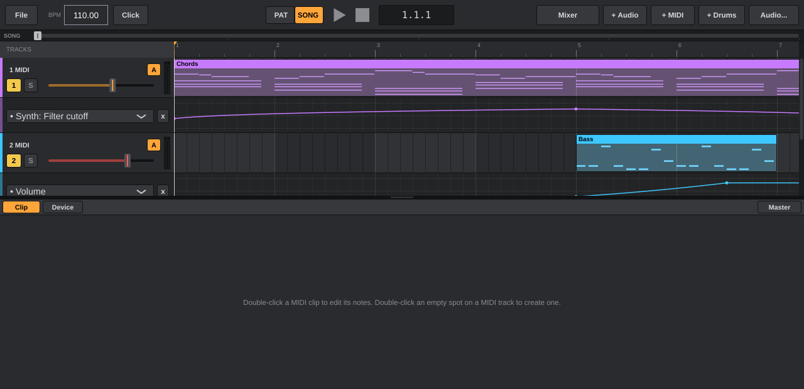
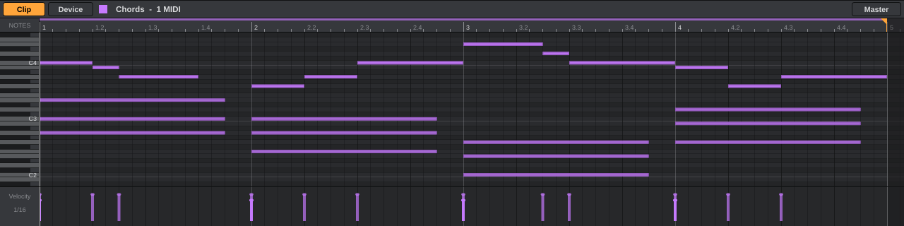
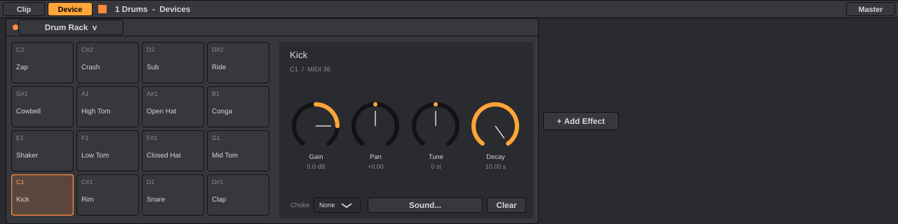
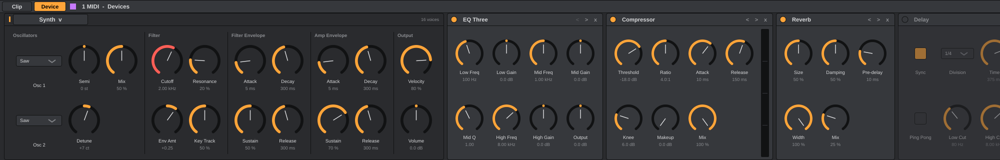
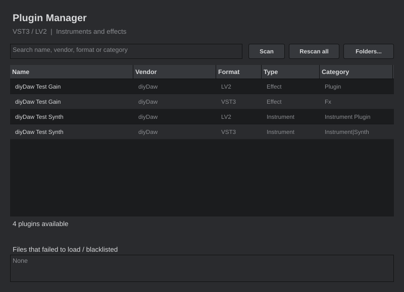

🇬🇧 English | 🇹🇷 [Türkçe](README.tr.md)

# diyDaw

**diyDaw** is a digital audio workstation (DAW) written from scratch for Linux. It combines
Ableton Live's arrangement and device workflow with FL Studio's patterns and piano roll.
Built with C++20 and [JUCE 9](https://juce.com), its audio engine follows real-time constraints:
no memory allocation, locks, or file access on the audio thread.



## Features

| Area | Features |
| --- | --- |
| **Arrangement** | Multitrack timeline, audio and MIDI clips, drag-and-drop audio import, move / trim / split / duplicate / loop, Ableton-style overlap handling that cuts underlying clips, grid snapping, zoom, playhead follow |
| **MIDI** | MIDI tracks, piano roll (draw, move, and resize notes, velocity lane, right-click deletion), live playing from a computer keyboard or MIDI keyboard |
| **Instruments** | Built-in 16-voice synth (2 oscillators, resonant filter, two envelopes), 16-pad drum rack with a kit synthesized inside the app, VST3 / LV2 instrument plugins |
| **Effects** | EQ Three, Compressor, Reverb, Delay (tempo sync, ping-pong); effect chains on every track and the master; VST3 / LV2 effect plugins |
| **Automation** | Draw envelopes for volume, pan, and every built-in device parameter; automated controls turn red and follow the envelope |
| **Playback** | Song mode and FL-style Pattern mode (loops the open clip on its own), metronome, draggable song position bar |
| **Mixer** | Channel strips (pan, activator, solo, fader, level meter), master strip |
| **Files** | XML `.diydaw` projects, relative paths that keep audio files accessible when a project folder moves, 16/24/32-bit WAV export (normalization, effect tails) |
| **Undo** | Almost every edit can be undone with Ctrl+Z; one mouse gesture = one undo step |

## Quick start

```bash
# 1. Clone the source, including JUCE
git clone --recursive https://github.com/barlasardic/diyDaw.git
cd diyDaw

# 2. Install dependencies (Ubuntu / Debian)
sudo apt install build-essential cmake ninja-build \
    libasound2-dev libjack-jackd2-dev \
    libfreetype-dev libfontconfig1-dev \
    libx11-dev libxcomposite-dev libxcursor-dev libxext-dev \
    libxinerama-dev libxrandr-dev libxrender-dev libxi-dev \
    libegl-dev libglu1-mesa-dev mesa-common-dev

# 3. Build
cmake -S . -B build -G Ninja -DCMAKE_BUILD_TYPE=Debug
cmake --build build

# 4. Run with an example project
./build/DiyDaw_artefacts/Debug/diyDaw examples/midi-demo.diydaw
```

Run the tests:

```bash
cmake --build build --target DawEngineTests
./build/DawEngineTests_artefacts/Debug/DawEngineTests     # Should print "ALL TESTS PASSED"
```

## Documentation

| Document | Contents |
| --- | --- |
| [User guide](docs/user-guide.md) | A step-by-step tour: tracks, clips, piano roll, synth, drum rack, effects, automation, patterns, plugins, export |
| [Shortcuts](docs/shortcuts.md) | All keyboard and mouse shortcuts on one page |
| [Architecture](docs/architecture.md) | Layers, threads, data flow, audio engine, model, plugin hosting |
| [Project file format](docs/file-format.md) | Detailed `.diydaw` format reference |
| [Development](docs/development.md) | Building, tests, tools, coding conventions, adding an effect |
| [AGENTS.md](AGENTS.md) | A short technical guide for contributors and coding agents |

Türkçe: [README.tr.md](README.tr.md)

## Screenshots

| | |
| --- | --- |
|  |  |
| Piano roll: notes, velocity lane, loop region | Drum rack: 16 pads and selected-pad controls |
|  |  |
| Synth and effect chain | VST3 / LV2 Plugin Manager |

## Status

diyDaw is under active development. The core parts of a working DAW are in place, but automation
recording, plugin parameter automation, plugin latency compensation, audio time stretching
(warp), a session view, and microphone / line-in recording are not yet available. See
[Known limitations](docs/user-guide.md#known-limitations) in the user guide for details.

## License

No license file has been added yet. JUCE is dual-licensed under the AGPLv3 or a commercial
license, so the project's license must be compatible with the applicable JUCE license terms.
