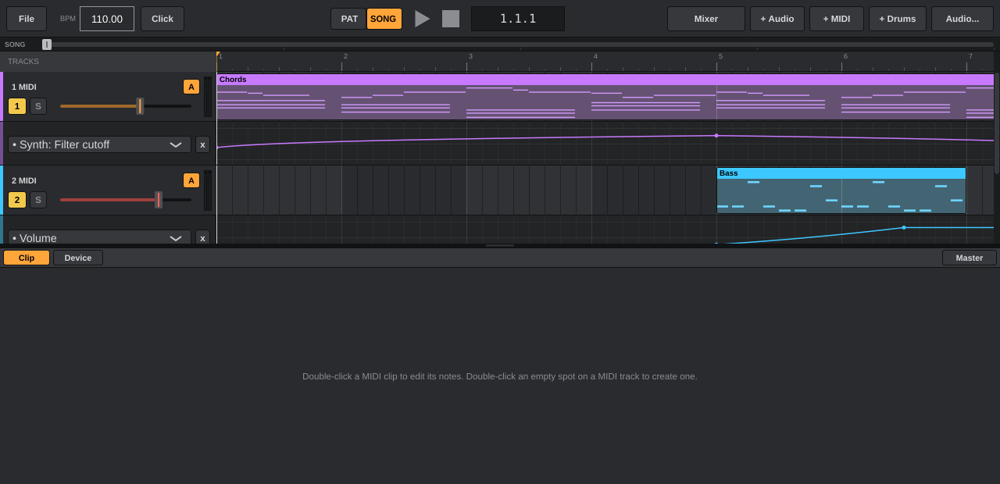
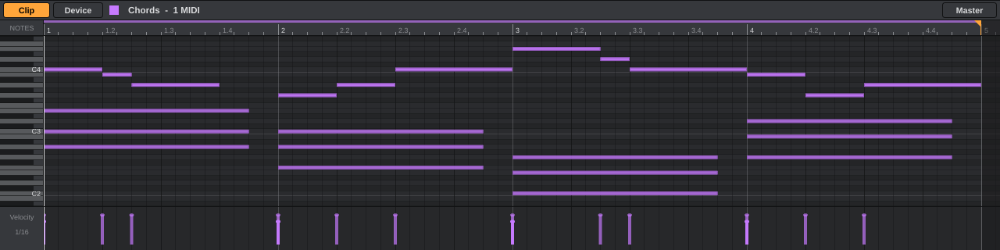
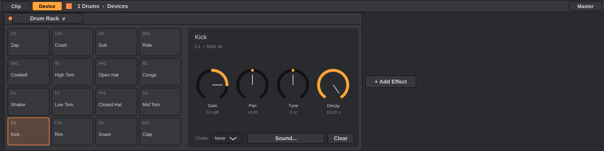
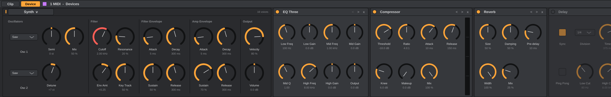
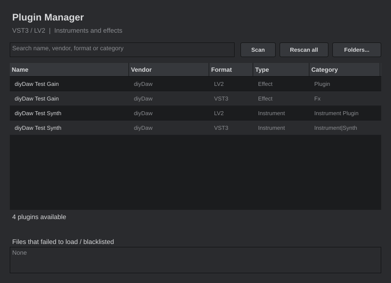

🇬🇧 [English](README.md) | 🇹🇷 Türkçe

# diyDaw

**diyDaw**, Linux için sıfırdan yazılmış, Ableton Live'ın arrangement/device mantığını FL Studio'nun
pattern ve piano roll hissiyle birleştiren bir dijital ses iş istasyonudur (DAW). C++20 ve
[JUCE 9](https://juce.com) ile yazılmıştır; ses motoru gerçek zamanlı kurallara göre (ses
thread'inde bellek ayırma, kilit, dosya erişimi yok) tasarlanmıştır.



## Neler yapabilir?

| Alan | Özellikler |
| --- | --- |
| **Arrangement** | Çok track'li zaman çizelgesi, ses ve MIDI clip'leri, sürükle-bırak ile ses dosyası ekleme, taşıma / kırpma / bölme / çoğaltma / loop, Ableton'daki gibi "üstüne bırakılan clip alttakini keser" kuralı, ızgaraya yapışma, zoom, playhead takibi |
| **MIDI** | MIDI track'leri, piano roll (nota çizme, taşıma, uzatma, velocity şeridi, sağ tıkla silme), bilgisayar klavyesiyle ve MIDI klavyeyle canlı çalma |
| **Enstrümanlar** | 16 sesli dahili synth (2 osilatör, rezonanslı filtre, iki envelope), 16 pad'li drum rack ve programın içinde sentezlenen hazır davul kiti, VST3 / LV2 enstrüman eklentileri |
| **Efektler** | EQ Three, Compressor, Reverb, Delay (tempoya senkron, ping-pong); her track'te ve master'da efekt zinciri; VST3 / LV2 efekt eklentileri |
| **Otomasyon** | Volume, pan ve her cihaz parametresi için zarf (envelope) çizimi; otomasyonlu düğmeler kırmızıya döner ve eğriyi takip eder |
| **Çalma** | Song modu ve FL tarzı Pattern modu (açık clip'i tek başına döngüde çalar), metronom, sürüklenebilir şarkı konum çubuğu |
| **Mikser** | Kanal şeritleri (pan, aç/kapa, solo, fader, seviye ölçer), master şeridi |
| **Dosyalar** | `.diydaw` proje dosyası (XML), proje klasörü taşınsa da ses dosyalarını bulan göreli yollar, 16/24/32-bit WAV export (normalize, efekt kuyruğu) |
| **Geri alma** | Neredeyse her düzenleme Ctrl+Z ile geri alınabilir; bir fare hareketi = bir geri alma adımı |

## Hızlı başlangıç

```bash
# 1. Kaynak kodu JUCE ile birlikte indir
git clone --recursive https://github.com/barlasardic/diyDaw.git
cd diyDaw

# 2. Gerekli paketler (Ubuntu / Debian)
sudo apt install build-essential cmake ninja-build \
    libasound2-dev libjack-jackd2-dev \
    libfreetype-dev libfontconfig1-dev \
    libx11-dev libxcomposite-dev libxcursor-dev libxext-dev \
    libxinerama-dev libxrandr-dev libxrender-dev libxi-dev \
    libegl-dev libglu1-mesa-dev mesa-common-dev

# 3. Derle
cmake -S . -B build -G Ninja -DCMAKE_BUILD_TYPE=Debug
cmake --build build

# 4. Çalıştır (örnek bir projeyle)
./build/DiyDaw_artefacts/Debug/diyDaw examples/midi-demo.diydaw
```

Testleri çalıştırmak için:

```bash
cmake --build build --target DawEngineTests
./build/DawEngineTests_artefacts/Debug/DawEngineTests     # "ALL TESTS PASSED" yazmalı
```

## Dokümantasyon

| Belge | İçerik |
| --- | --- |
| [Kullanım kılavuzu](docs/tr/kullanim-kilavuzu.md) | Arayüzün tamamı, adım adım: track'ler, clip'ler, piano roll, synth, drum rack, efektler, otomasyon, pattern modu, eklentiler, export |
| [Kısayollar](docs/tr/kisayollar.md) | Bütün klavye ve fare kısayolları tek sayfada |
| [Mimari](docs/tr/mimari.md) | Programın iç yapısı: katmanlar, thread'ler, veri akışı, ses motoru, model, eklenti barındırma |
| [Proje dosyası formatı](docs/tr/dosya-formati.md) | `.diydaw` dosyasının ayrıntılı tanımı |
| [Geliştirme](docs/tr/gelistirme.md) | Derleme, testler, yardımcı araçlar, kod kuralları, yeni bir efekt eklemek |
| [AGENTS.md](AGENTS.md) | Kod üzerinde çalışan geliştiriciler ve yapay zekâ ajanları için kısa teknik rehber (İngilizce) |

## Ekran görüntüleri

| | |
| --- | --- |
|  |  |
| Piano roll: notalar, velocity şeridi, loop bölgesi | Drum rack: 16 pad ve seçili pad'in ayarları |
|  |  |
| Synth ve efekt zinciri | VST3 / LV2 eklenti yöneticisi |

## Durum

diyDaw aktif geliştirme altındadır. Çalışan bir DAW'ın temel parçaları yerindedir, ama henüz
şunlar yoktur: otomasyon kaydı, eklenti parametrelerinin otomasyonu, eklenti gecikme telafisi,
ses clip'lerinde tempo uydurma (warp), session view, ses kaydı (mikrofon / line-in). Ayrıntılar için
kullanım kılavuzundaki [Bilinen sınırlar](docs/tr/kullanim-kilavuzu.md#bilinen-sınırlar) bölümüne bakın.

## Lisans

Telif hakkı (C) 2026 diyDaw katkıda bulunanları.

diyDaw özgür bir yazılımdır: Free Software Foundation tarafından yayımlanan **GNU Affero Genel
Kamu Lisansı, sürüm 3** (ya da tercihinize göre daha sonraki bir sürüm) koşulları altında
dağıtabilir ve/veya değiştirebilirsiniz. Lisansın tam metni (İngilizce) için
[LICENSE.md](LICENSE.md) dosyasına bakın.

diyDaw yararlı olması umuduyla, ancak HİÇBİR GARANTİ OLMAKSIZIN dağıtılmaktadır; SATILABİLİRLİK
ya da BELİRLİ BİR AMACA UYGUNLUK zımni garantisi dahi yoktur.

diyDaw, AGPLv3 lisans seçeneğiyle kullanılan [JUCE](https://juce.com) üzerine kuruludur. Üçüncü
taraf kodlar kendi lisanslarını korur: JUCE (`external/JUCE`) ve onunla gelen VST3 / LV2 SDK'ları.
