🇬🇧 [English](../user-guide.md) | 🇹🇷 Türkçe

# diyDaw Kullanım Kılavuzu

Bu kılavuz diyDaw'ı ilk kez açan birinin bilmesi gereken her şeyi, ekranın üstünden altına doğru
anlatır. Kısayolların tamamı ayrıca [kisayollar.md](kisayollar.md) dosyasında listelenmiştir.

**İçindekiler**

1. [Temel kavramlar](#1-temel-kavramlar)
2. [Ekranın genel düzeni](#2-ekranın-genel-düzeni)
3. [Üst bar (transport)](#3-üst-bar-transport)
4. [Konum çubuğu](#4-konum-çubuğu)
5. [Track'ler](#5-trackler)
6. [Arrangement: clip'lerle çalışmak](#6-arrangement-cliplerle-çalışmak)
7. [Ses dosyaları ve ses clip'leri](#7-ses-dosyaları-ve-ses-clipleri)
8. [MIDI clip'leri ve piano roll](#8-midi-clipleri-ve-piano-roll)
9. [Canlı çalma: bilgisayar klavyesi ve MIDI klavye](#9-canlı-çalma-bilgisayar-klavyesi-ve-midi-klavye)
10. [Alt panel: Clip ve Device sekmeleri](#10-alt-panel-clip-ve-device-sekmeleri)
11. [Synth](#11-synth)
12. [Drum rack](#12-drum-rack)
13. [Efektler](#13-efektler)
14. [Master kanalı](#14-master-kanalı)
15. [Otomasyon](#15-otomasyon)
16. [Pattern modu (FL tarzı)](#16-pattern-modu-fl-tarzı)
17. [Mikser görünümü](#17-mikser-görünümü)
18. [VST3 ve LV2 eklentileri](#18-vst3-ve-lv2-eklentileri)
19. [Projeler: kaydetme, açma, dosyalar](#19-projeler-kaydetme-açma-dosyalar)
20. [Ses olarak dışa aktarma (export)](#20-ses-olarak-dışa-aktarma-export)
21. [Ses ayarları](#21-ses-ayarları)
22. [Geri alma (undo) nasıl çalışır?](#22-geri-alma-undo-nasıl-çalışır)
23. [Pencere düzeni ve kalıcı ayarlar](#23-pencere-düzeni-ve-kalıcı-ayarlar)
24. [Örnek bir çalışma akışı](#24-örnek-bir-çalışma-akışı)
25. [Sorun giderme](#25-sorun-giderme)
26. [Bilinen sınırlar](#bilinen-sınırlar)

---

## 1. Temel kavramlar

diyDaw'da bir müzik projesi şu parçalardan oluşur:

- **Track (kanal):** Zaman çizelgesinde yatay bir şerit. İki türü vardır:
  - **Audio track:** ses dosyalarından oluşan *ses clip'leri* çalar.
  - **MIDI track:** nota içeren *MIDI clip'leri* çalar. Notaları sese çeviren bir **enstrümanı**
    vardır: dahili synth, drum rack ya da bir VST3/LV2 eklentisi. "Drum track" aslında
    enstrümanı drum rack olan bir MIDI track'tir.
- **Clip:** Track üzerindeki, başı ve sonu belli bir parça. Bir clip **loop** (döngü) modunda
  olabilir; o zaman içeriği clip boyunca tekrar eder.
- **Device (cihaz):** Bir track'in ses zincirindeki her eleman: önce enstrüman (MIDI track'lerde),
  sonra sırayla efektler. Efektlerden çıkan ses track'in fader'ına ve pan'ına gider.
- **Master:** Bütün track'lerin toplandığı son kanal. Master'ın da kendi efekt zinciri ve fader'ı
  vardır.
- **Beat ve bar:** Zaman beat (vuruş, dörtlük nota) cinsinden ölçülür. Varsayılan ölçü 4/4'tür:
  1 bar = 4 beat. Konum göstergesindeki `3.2.1` "3. bar, 2. vuruş, 1. on altılık" demektir.
- **Tempo (BPM):** Dakikadaki vuruş sayısı. Tempo değişince MIDI clip'leri yeni tempoya uyar;
  ses clip'leri ise **kendi hızında** çalmaya devam eder (henüz "warp" yoktur, bkz.
  [Bilinen sınırlar](#bilinen-sınırlar)).

## 2. Ekranın genel düzeni

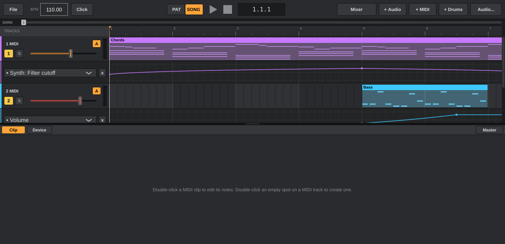

Yukarıdan aşağı:

1. **Üst bar (transport):** dosya menüsü, tempo, metronom, Pattern/Song, çal/dur, konum, görünüm
   ve track ekleme düğmeleri.
2. **Konum çubuğu:** şarkının tamamını gösteren ince çubuk. Tutup sürükleyerek şarkıda
   gezinebilirsin.
3. **Ana alan:** Arrangement (zaman çizelgesi) ya da Mikser. İkisi arasında **Tab** ile geçilir.
4. **Ayırıcı çubuk:** ana alan ile alt panel arasındaki ince çubuk. Sürükleyerek alt panelin
   yüksekliğini değiştirirsin, çift tıklayınca alt panel kapanır ya da açılır.
5. **Alt panel (detail view):** seçili clip'in editörü (piano roll) ya da seçili track'in cihaz
   zinciri.

Pencere başlığında projenin adı yazar. Kaydedilmemiş değişiklik varsa adın sonunda `*` çıkar
(örneğin `Şarkım* - diyDaw`).

## 3. Üst bar (transport)

Soldan sağa:

| Öğe | Ne yapar? |
| --- | --- |
| **File** | Yeni proje, aç, kaydet, farklı kaydet, ses olarak dışa aktar, eklenti yöneticisi |
| **BPM** | Tempo. Kutunun üzerinde fareyi yukarı-aşağı sürükleyerek değiştirilir, çift tıklayınca 120'ye döner. Tempo değişikliği geri alınabilir ve otomasyonla değil, proje ayarı olarak saklanır |
| **Click** | Metronomu açar/kapatır. Metronom bar başlarında daha tiz çalar. Export'a dahil edilip edilmeyeceği export penceresinden seçilir |
| **PAT / SONG** | Çalma modu. SONG bütün şarkıyı, PAT sadece piano roll'da açık olan clip'i döngüde çalar (bkz. [Pattern modu](#16-pattern-modu-fl-tarzı)) |
| **▶ (Play)** | Çalmayı başlatır. Pattern modunda konum clip'in dışındaysa clip'in başından başlar |
| **■ (Stop)** | İlk basış durdurur. Duruyorken ikinci basış başa sarar (pattern modunda clip'in başına) |
| **Konum göstergesi** | `bar.vuruş.on altılık` biçiminde çalma konumu |
| **Mixer / Arrangement** | Mikser ile arrangement arasında geçiş (Tab ile aynı) |
| **+ Audio** | Yeni audio track (Ctrl+T) |
| **+ MIDI** | Synth'li yeni MIDI track (Ctrl+Shift+T) |
| **+ Drums** | Drum rack'li ve hazır kitli yeni drum track (Ctrl+Alt+T) |
| **Audio...** | Ses kartı ayarları (bkz. [Ses ayarları](#21-ses-ayarları)) |

Çalmayı başlatıp durdurmanın en hızlı yolu **Space** tuşudur.

## 4. Konum çubuğu

Üst barın hemen altındaki ince çubuk FL Studio'daki "song position" çubuğunun karşılığıdır.

- Soldaki etiket **SONG** ya da **PATTERN** yazar.
- Çubuk şarkının tamamını kaplar (son clip'in bittiği bardan bir bar sonrasına kadar). Çalma
  ilerledikçe dolar.
- **Tıkla:** çalma konumu oraya atlar.
- **Tutup sürükle:** konum fareyi takip eder (scrub). Konum 16'lık notalara yapışır, **Alt**
  basılıyken serbest hareket eder.
- Pattern modunda çubuk sadece o clip'in uzunluğunu gösterir.

## 5. Track'ler

### Track eklemek

- **+ Audio** / **Ctrl+T**: audio track.
- **+ MIDI** / **Ctrl+Shift+T**: dahili synth'li MIDI track.
- **+ Drums** / **Ctrl+Alt+T**: drum rack'li track (hazır kit yüklü gelir).
- Bir ses dosyasını arrangement'ın en altındaki boş alana sürükleyip bırakmak da yeni bir audio
  track açar.

Yeni bir proje 2 MIDI ve 2 audio track ile başlar. Bir projede en fazla **16 track** olabilir.

### Track başlığı

Her track'in solunda bir başlık vardır:

- **Renk şeridi:** track'in rengi; clip'ler de bu renkte çizilir.
- **İsim:** çift tıklayarak değiştir (geri alınabilir).
- **Numaralı sarı düğme (aktivatör):** yanıyorsa track duyulur; söndürürsen track susar (mute).
  Ableton'daki "track activator" ile aynı mantık.
- **S (solo):** sadece solo'lu track'ler duyulur. Birden fazla track solo olabilir.
- **Yatay sürgü:** track'in ses seviyesi (−60 dB ile +6 dB arası; çift tıkla 0 dB'ye döner).
- **A:** otomasyon şeridini açar/kapatır (bkz. [Otomasyon](#15-otomasyon)).
- **Seviye ölçer:** track'in o anki çıkış seviyesi.

### Track yüksekliği ve başlık genişliği

- Bir track'in **alt kenarını** (başlıkta ya da clip alanında, kenara yakın ince bölge) yukarı-aşağı
  sürükleyerek yüksekliğini değiştir (40–320 piksel). Kenara **çift tıklarsan** varsayılan
  yüksekliğe (64 piksel) döner. Yükseklikler projeyle kaydedilir.
- Track başlıkları ile zaman çizelgesi arasındaki **dikey çizgiyi** sağa-sola sürükleyerek
  başlık sütununun genişliğini değiştir (140–360 piksel). Bu genişlik uygulama ayarı olarak
  saklanır.
- Track çok alçaksa başlıkta sadece isim ve düğmeler kalır; sürgü ve ölçer gizlenir.

### Track seçmek

Bir track'in clip alanına tıklamak o track'i seçer. Seçili track:

- alt paneldeki **Device** sekmesinde görünür,
- MIDI track ise **canlı çalma** (bilgisayar klavyesi, MIDI klavye) ona gider.

## 6. Arrangement: clip'lerle çalışmak

### Zaman cetveli ve playhead

- Arrangement'ın üstünde bar numaralı **zaman cetveli** vardır.
- Cetvele **tıklamak** çalma konumunu oraya taşır (ızgaraya yapışır, Alt ile serbest).
- Cetvelde fareyi **yukarı-aşağı sürüklemek** zoom yapar.
- İnce dikey çizgi **playhead**'dir (çalma konumu). Çalarken playhead ekrandan çıkarsa görünüm
  sayfa sayfa takip eder.
- Track'lerdeki boş bir alana tıklamak da playhead'i oraya taşır ve clip seçimini kaldırır.

### Zoom ve kaydırma

| Hareket | Sonuç |
| --- | --- |
| **Ctrl + tekerlek** | Farenin olduğu nokta etrafında zoom |
| **Tekerlek** | Track'ler ekrana sığmıyorsa dikey kaydırma, sığıyorsa zamanda kaydırma |
| **Shift + tekerlek** / yatay touchpad kaydırma | Zamanda kaydırma |
| Cetvelde dikey sürükleme | Zoom |

Izgara çizgilerinin sıklığı zoom'a göre kendiliğinden değişir (1/16'dan barlara kadar). Bar
çizgileri daha parlaktır.

### Clip seçmek ve düzenlemek

| İşlem | Nasıl? |
| --- | --- |
| Seç | Clip'e tıkla (aynı anda tek clip seçilir) |
| Taşı | Clip'in gövdesinden tutup sürükle. Izgaraya yapışır; **Alt** ile serbest. Aynı türden başka bir track'e de taşınabilir (ses → ses, MIDI → MIDI) |
| Başını / sonunu kırp | Clip'in sol ya da sağ kenarına (~6 piksel) gel; imleç ↔ olunca sürükle |
| Sil | **Delete** ya da **Backspace** |
| Çoğalt | **Ctrl+D**: kopya, clip'in bittiği yere yerleşir |
| Böl | Playhead'i clip'in içine getir ve **Ctrl+E** |
| Loop aç/kapat | **Ctrl+L** |
| Sürüklemeyi iptal et | Sürüklerken **Escape** |
| Aç (MIDI) | Clip'e çift tıkla: alt panelde piano roll açılır |
| Yeni MIDI clip | MIDI track'te boş bir yere çift tıkla: o bara 1 barlık boş, döngülü bir clip eklenir ve açılır |

Sürüklerken clip'in yeni yeri yarı saydam bir "hayalet" olarak gösterilir; fareyi bıraktığında
değişiklik uygulanır ve tek bir geri alma adımı olur.

### Üst üste binme kuralı (Ableton gibi)

Bir track'te clip'ler asla üst üste binmez. Bir clip'i başka bir clip'in üstüne taşır, uzatır,
çoğaltır ya da oraya yeni bir clip eklersen **alttaki clip kesilir**:

- tamamen kaplanıyorsa silinir,
- sadece bir ucu kaplanıyorsa o ucu kırpılır,
- ortası kaplanıyorsa ikiye bölünür.

Hepsi tek bir Ctrl+Z ile geri alınır.

### Loop'lu clip'ler

- **Ses clip'i loop'tayken** sağ kenarından sürükleyerek istediğin kadar uzatabilirsin; ses
  dosyası baştan tekrar eder. Loop kapalıyken bir ses clip'i, ses dosyasının kendisinden uzun
  olamaz.
- **MIDI clip'i loop'tayken** içeriği her *loop uzunluğu* kadar tekrar eder. Loop uzunluğu piano
  roll'un cetvelindeki turuncu işaretle değiştirilir (bkz. [Piano roll](#8-midi-clipleri-ve-piano-roll)).
  Yeni MIDI clip'leri loop açık başlar.
- Bir clip'in **sol kenarını** kırpınca içerik yerinde kalır; sadece görünen pencere değişir.
  Loop'lu clip'lerde sol kenarı sola doğru da uzatabilirsin (içerik geriye doğru tekrar eder).

## 7. Ses dosyaları ve ses clip'leri

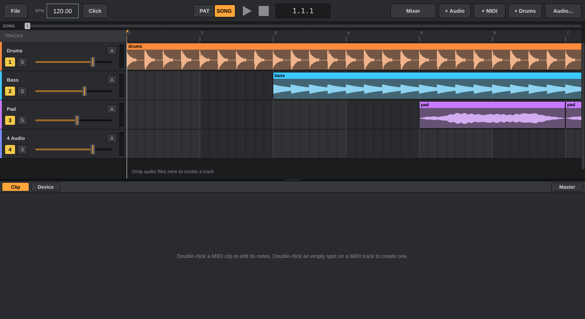

- Dosya yöneticisinden bir ya da birkaç ses dosyasını (WAV, AIFF, FLAC, OGG Vorbis; MP3 henüz
  desteklenmiyor) bir audio
  track'in üstüne **sürükleyip bırak**. Clip, bıraktığın yere (ızgaraya yapışarak) yerleşir. Birden
  fazla dosya bırakırsan arka arkaya dizilirler.
- En alttaki boş alana bırakırsan yeni bir audio track açılır. MIDI track'in üstüne bırakırsan
  da yeni bir audio track açılır.
- Dosyalar arka planda yüklenir; büyük dosyalar yüklenirken clip'te **Loading...** yazar ve arayüz
  donmaz.
- Clip'in içinde dalga formu (waveform) çizilir.
- Dosya bulunamazsa (silinmiş, taşınmış) clip kırmızı **Missing file** yazısıyla gösterilir ve
  sessiz kalır.
- Clip başlarında ve sonlarında çok kısa (2 ms) bir yumuşatma uygulanır; kesme noktalarında tık
  sesi duyulmaz.
- Uzunluk sınırı: en fazla 10 dakikalık, mono veya stereo dosyalar.

**Tempo ve ses clip'leri:** Ses clip'leri her zaman kendi doğal hızında çalar. Bir clip'i
eklediğinde uzunluğu o anki tempoya göre beat'e çevrilir. Sonra tempoyu değiştirirsen clip'in
ızgaradaki uzunluğu aynı kalır, ama ses aynı hızda çalmaya devam eder; yani ses ızgaradan
kayabilir.

## 8. MIDI clip'leri ve piano roll

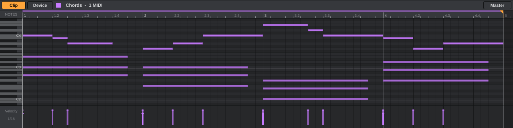

Bir MIDI clip'e çift tıkladığında alt panelin **Clip** sekmesinde piano roll açılır.

### Piano roll'un bölümleri

- **Sol: klavye.** Her satır bir notadır; C notaları etiketlidir (**C3 = MIDI 60**, orta Do).
  Tuşa tıklarsan nota çalınır (dinleme). Drum track'lerde klavye yerine pad isimleri yazar.
- **Üst: cetvel.** Bar ve vuruş numaraları clip'in *içerik zamanına* göredir (clip'in başı = 1).
  Sağdaki turuncu işaret **loop sonudur**. Loop bölgesinin dışı daha koyu çizilir.
- **Orta: nota ızgarası.** Notalar track renginde dikdörtgenlerdir; soluklukları velocity'yi
  gösterir. Seçili notalar daha parlak ve çerçevelidir.
- **Alt: velocity şeridi.** Her notanın velocity'si (vuruş gücü) dikey bir çubuk olarak gösterilir.
  Sol alttaki yazı geçerli ızgara çözünürlüğünü gösterir (örneğin `1/16`).

### Notalarla çalışmak

| İşlem | Nasıl? |
| --- | --- |
| Nota ekle | Boş yere **çift tıkla**. Nota ızgara uzunluğunda olur; tuşu bırakmadan sürükleyerek yerini ayarlayabilirsin |
| Seç | Notaya tıkla. **Shift** ya da **Ctrl** ile tıklayınca seçime ekle/çıkar |
| Çoklu seç | Boş yerden başlayıp sürükle (seçim dikdörtgeni) |
| Hepsini seç | **Ctrl+A** |
| Taşı | Seçili notaları sürükle: yatayda zaman (ızgaraya yapışır, **Alt** serbest), dikeyde perde |
| Uzat / kısalt | Notanın sağ kenarını sürükle (bütün seçili notalar birlikte) |
| Sil | **Delete** / **Backspace**, ya da notaya **sağ tıkla** |
| Silgi | **Sağ tuşu basılı tutup** notaların üzerinden geç: geçtiğin notalar silinir (FL Studio gibi). Bir sürüklemede silinenlerin hepsi tek Ctrl+Z ile geri gelir |
| Çoğalt | **Ctrl+D**: seçim kendisinden hemen sonraya kopyalanır |
| Transpoze | **↑ / ↓**: yarım ton; **Shift + ↑ / ↓**: bir oktav |
| Zamanda kaydır | **← / →**: bir ızgara adımı |
| Velocity | Velocity şeridinde bir notanın çubuğunu yukarı-aşağı sürükle (seçili notalar birlikte değişir) |
| Loop uzunluğu | Cetveldeki turuncu loop sonu işaretini sürükle |
| Çalma konumu | Cetvele tıkla ya da cetvelde sürükle: playhead o noktaya gider |
| İptal | Sürüklerken **Escape** |

Notaları eklerken ve taşırken nota sesi duyulur, böylece doğru perdeyi bulmak kolaylaşır.

### Gezinme

| Hareket | Sonuç |
| --- | --- |
| **Tekerlek** | Perdede yukarı-aşağı kaydırma |
| **Shift + tekerlek** | Zamanda kaydırma |
| **Ctrl + tekerlek** | Zamanda zoom |
| **Alt + tekerlek** (ya da **Ctrl + Shift + tekerlek**) | Tuşları ve notaları uzat / kısalt (dikey zoom, FL gibi) |
| Sol üst köşedeki **−** / **+** | Aynısı, görünümün ortasına göre |
| Klavyenin sağ kenarını sürükleme | Klavyeyi genişlet / daralt |

### Tuş ve nota boyutu

FL Studio'daki gibi tuşların ve notaların boyutu ayarlanabilir; böylece nota yazmak kolaylaşır:

- **Satır yüksekliği** (bir tuş / bir nota satırı) 6 ile 40 piksel arasıdır (varsayılan 12).
  Klavyenin ya da ızgaranın üzerinde **Alt + tekerlek** kullan: farenin altındaki nota yerinde
  kalır. Klavyenin üstündeki **−** / **+** düğmeleri aynı işi fareyle yapar. Bazı masaüstleri
  Alt + tekerleği kendine ayırır; **Ctrl + Shift + tekerlek** de çalışır.
- **Klavye genişliği** 40 ile 200 piksel arasıdır (varsayılan 56): klavye ile notalar arasındaki
  çizgiyi sürükle (imleç ↔ olur).
- Satırlar uzayınca sadece C'lerin değil her beyaz tuşun adı (D3, E3, ...) yazar, drum track'lerde
  pad isimleri büyür. Nota blokları adlarını (perde ya da drum track'lerde pad adı) notanın içine
  sığıyorsa gösterir.
- İki boyut da bütün clip'lerde geçerlidir ve uygulama ayarlarında saklanır.

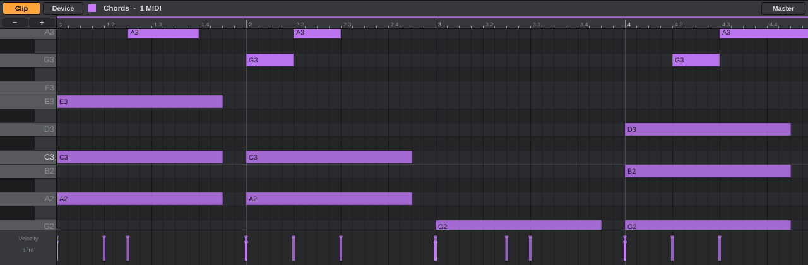

Piano roll açıldığında görünüm notaları ortalayacak şekilde ve bütün loop'u gösterecek şekilde
ayarlanır. Çalarken playhead piano roll'da da görünür; loop'lu clip'lerde içerik zamanına göre
döner.

## 9. Canlı çalma: bilgisayar klavyesi ve MIDI klavye

Seçili track bir MIDI track ise onu canlı çalabilirsin:

### Bilgisayar klavyesi (Ableton düzeni)

```
  W E   T Y U   O P        ← siyah tuşlar
 A S D F G H J K L ;       ← beyaz tuşlar
 C D E F G A B C D E
```

| Tuş | Görev |
| --- | --- |
| `A S D F G H J K L ;` | Beyaz tuşlar (C'den başlayarak) |
| `W E T Y U O P` | Siyah tuşlar |
| `Z` / `X` | Bir oktav aşağı / yukarı (başlangıçta A tuşu C3 = MIDI 60'tır) |
| `C` / `V` | Velocity'yi 0,1 azalt / artır (başlangıç 0,8) |

Notalar tuşu bıraktığında susar. Bu tuşlar sadece **Ctrl, Alt veya Shift basılı değilken** ve bir
MIDI track seçiliyken çalışır. Drum track'lerde A tuşu C3'ü çalar; kick'i (C1) duymak için iki kez
Z'ye basıp oktavı indir.

### MIDI klavye

Bilgisayara bağlı bütün MIDI giriş cihazları otomatik olarak açılır ve **seçili MIDI track'i**
çalar (Ableton'daki "auto-arm" gibi). Note-on, note-off ve "all notes off" mesajları desteklenir.

> Şu an canlı çalınan notalar kaydedilmez; sadece dinlenir.

## 10. Alt panel: Clip ve Device sekmeleri

Alt panelin üst şeridinde:

- **Clip** sekmesi: seçili/açık clip'in editörü. MIDI clip'lerde piano roll; ses clip'leri için
  henüz editör yoktur.
- **Device** sekmesi: seçili track'in cihaz zinciri (enstrüman + efektler).
- Ortada: açık clip'in ya da track'in adı ve rengi.
- Sağda: **Master** düğmesi, master kanalının efekt zincirini açar.

**Shift+Tab** iki sekme arasında geçiş yapar. Panelin yüksekliğini üstündeki ayırıcıyı
sürükleyerek değiştir; ayırıcıya çift tıklayınca panel kapanıp açılır.

Cihaz zinciri ekrana sığmazsa altta yatay bir kaydırma çubuğu çıkar.

## 11. Synth

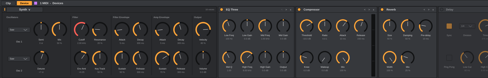

Her yeni MIDI track dahili synth ile gelir: 16 sesli (aynı anda 16 nota), "subtractive"
(çıkarımlı) bir synth. Ses akışı: **iki osilatör → karıştırıcı → rezonanslı alçak geçiren filtre →
ses envelope'u → çıkış**.

| Bölüm | Parametre | Aralık (varsayılan) | Açıklama |
| --- | --- | --- | --- |
| Oscillators | Osc 1 / Osc 2 | Saw, Square, Triangle, Sine (Saw) | Dalga biçimi. Saw ve square, aliasing (dijital bozulma) yapmayan "band-limited" yöntemle üretilir |
| | Semi | −24 … +24 yarım ton (0) | Osc 2'nin perdesi |
| | Detune | −50 … +50 cent (+7) | Osc 2'nin ince ayarı; hafif detune "kalın" bir ses verir |
| | Mix | %0 … %100 (%50) | %0 sadece Osc 1, %100 sadece Osc 2 |
| Filter | Cutoff | 20 Hz … 20 kHz (2 kHz) | Filtrenin kesim frekansı |
| | Resonance | %0 … %100 (%20) | Kesim frekansındaki vurgu; %100'e yakın değerler "ıslık" gibi ses verir |
| | Env Amt | −1 … +1 (+0,25) | Filtre envelope'unun cutoff'u ne kadar açacağı (±6 oktav) |
| | Key Track | %0 … %100 (%50) | Cutoff'un çalınan notayla birlikte yükselmesi |
| Filter Envelope | Attack / Decay / Sustain / Release | 1 ms … 10 s; sustain %0 … %100 | Filtrenin zaman içindeki açılıp kapanması |
| Amp Envelope | Attack / Decay / Sustain / Release | 5 ms / 300 ms / %70 / 300 ms | Sesin zaman içindeki seviyesi |
| Output | Velocity | %0 … %100 (%80) | Vuruş gücünün sese etkisi |
| | Volume | −60 … +6 dB (0 dB) | Synth'in çıkış seviyesi |

İpuçları:

- **Pad sesi:** Attack ve Release'i 500 ms'nin üstüne çıkar, Cutoff'u 1 kHz civarına indir.
- **Bas:** Osc 2 Semi = −12, Cutoff düşük, Resonance %30–40, Env Amt +0,5, Decay kısa.
- **Pluck (tırnaklı ses):** Sustain %0, Decay 150–300 ms, Env Amt yüksek.
- Bütün düğmeler çift tıklanınca varsayılana döner, sürüklerken değer bir baloncukta görünür ve
  her düğme hareketi tek bir geri alma adımıdır.

Synth yerine başka bir enstrüman kullanmak için synth panelinin başlığındaki açılır menüden
**Drum Rack** ya da bir **eklenti** seç (bkz. [Eklentiler](#18-vst3-ve-lv2-eklentileri)).

## 12. Drum rack

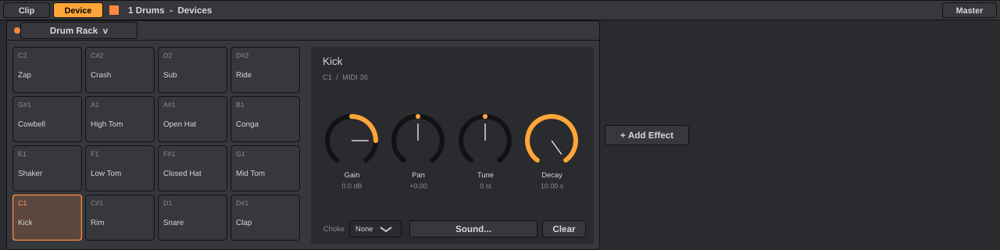

Drum rack, notaları sample (kayıtlı ses) çalan 16 **pad**'e dağıtan bir enstrümandır.
**+ Drums** düğmesiyle eklenen track hazır kitle gelir.

### Pad düzeni

Pad'ler Ableton'daki gibi **sol alttan** başlar: sol alt pad **C1 (MIDI 36)**, sağ üst pad
**D#2 (MIDI 51)**. Hazır kit General MIDI'ye yakın bir sırayla dizilmiştir:

| Nota | Pad | | Nota | Pad |
| --- | --- | --- | --- | --- |
| C1 (36) | Kick | | G#1 (44) | Cowbell |
| C#1 (37) | Rim | | A1 (45) | High Tom |
| D1 (38) | Snare | | A#1 (46) | Open Hat |
| D#1 (39) | Clap | | B1 (47) | Conga |
| E1 (40) | Shaker | | C2 (48) | Zap |
| F1 (41) | Low Tom | | C#2 (49) | Crash |
| F#1 (42) | Closed Hat | | D2 (50) | Sub (808 tarzı bas) |
| G1 (43) | Mid Tom | | D#2 (51) | Ride |

Hazır kitteki sesler dışarıdan bir dosya değildir; program açılırken kodla **sentezlenir**
(klasik davul makinesi tarifleriyle). Bu yüzden lisans derdi yoktur ve proje dosyası küçük kalır.

### Pad'lerle çalışmak

- **Pad'e tıkla:** pad seçilir ve sesi çalınır.
- **Sample yükle:** dosya yöneticisinden bir ses dosyasını bir pad'in üstüne sürükleyip bırak.
  Birden fazla dosya bırakırsan sıradaki pad'lere dağılır.
- **Sound...:** seçili pad'e hazır kitten başka bir ses koy.
- **Clear:** pad'i boşalt.

Sağ taraftaki ayarlar **seçili pad'e** aittir:

| Ayar | Aralık (varsayılan) | Açıklama |
| --- | --- | --- |
| Gain | −60 … +6 dB (0 dB) | Pad'in ses seviyesi |
| Pan | Sol … Sağ (orta) | Stereo konum |
| Tune | −24 … +24 yarım ton (0) | Perde; sample hızlandırılarak/yavaşlatılarak değiştirilir (yukarı = kısalır) |
| Decay | 10 ms … 10 s (10 s) | Sesin ne kadar sürede sönümleneceği. 10 s = sample sonuna kadar çalar |
| Choke | None, 1 … 8 (None) | Aynı choke grubundaki pad'ler birbirini keser. Hazır kitte kapalı ve açık hi-hat aynı gruptadır: kapalı hi-hat çalınca açık hi-hat susar |

Pad'ler **tek vuruşluktur (one-shot)**: nota bırakıldığında ses kesilmez, sample bitene ya da
decay'e kadar çalar. Velocity sesi doğrusal olarak etkiler. Aynı anda en fazla 32 ses çalabilir;
fazlası en eskisini yumuşakça keser.

### Drum track'te piano roll

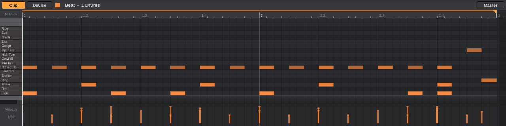

Drum track'lerde piano roll'un klavyesinde nota isimleri yerine **pad isimleri** (Kick, Snare,
Closed Hat...) yazar ve görünüm pad'lerin olduğu bölgede açılır. Notanın uzunluğu önemsizdir;
sadece başladığı yer ve velocity'si önemlidir.

Pad ayarları (gain, pan, tune, decay, choke) da otomatiklenebilir.

## 13. Efektler

Her track'in (audio ya da MIDI) ve master'ın bir **efekt zinciri** vardır. Efektler soldan sağa
sırayla işlenir; enstrümandan sonra, track fader'ından önce gelirler.

- **Ekle:** Device sekmesinde zincirin sonundaki **+ Add Effect** düğmesi. Menüde dahili efektler,
  **Plugins** alt menüsünde eklentiler ve **Manage plugins...** vardır.
- **Aç / kapat (bypass):** efektin başlığındaki yuvarlak düğme. Kapalı efekt soluk görünür.
  Açıp kapatırken ~10 ms'lik yumuşak geçiş yapılır, tık sesi olmaz.
- **Sırayı değiştir:** başlıktaki **<** ve **>** düğmeleri.
- **Sil:** başlıktaki **x** düğmesi.

Hepsi geri alınabilir ve projeyle kaydedilir.

### EQ Three

Üç bantlı ekolayzer: alçak frekans "shelf", orta "peak" ve yüksek frekans "shelf" filtreleri.

| Parametre | Aralık (varsayılan) |
| --- | --- |
| Low Freq / Low Gain | 20–1000 Hz (100 Hz) / −18…+18 dB (0) |
| Mid Freq / Mid Gain / Mid Q | 100 Hz–10 kHz (1 kHz) / −18…+18 dB (0) / 0,3–8 (1) |
| High Freq / High Gain | 1–20 kHz (8 kHz) / −18…+18 dB (0) |
| Output | −18…+18 dB (0) |

Bütün kazançlar 0 dB'deyken EQ sesi hiç değiştirmez.

### Compressor

Sesin yüksek kısımlarını bastırarak dinamiği daraltır. İki kanal birlikte (stereo bağlı) çalışır.

| Parametre | Aralık (varsayılan) | Açıklama |
| --- | --- | --- |
| Threshold | −60…0 dB (−18) | Bu seviyenin üstü bastırılır |
| Ratio | 1:1 … 20:1 (4:1) | Ne kadar bastırılacağı |
| Attack / Release | 0,1–100 ms (10) / 10–1000 ms (150) | Tepki ve bırakma hızı |
| Knee | 0–24 dB (6) | Geçişin yumuşaklığı |
| Makeup | 0–24 dB (0) | Bastırma sonrası seviyeyi geri yükseltme |
| Mix | %0–100 (%100) | Paralel sıkıştırma için kuru/işlenmiş oranı |

Panelin sağındaki dikey çubuk o anki **sıkıştırma miktarını** (gain reduction) gösterir.

### Reverb

Oda/salon yankısı. Pre-delay, oda boyutu, yüksek frekans sönümü ve stereo genişlik ayarlanabilir.

| Parametre | Aralık (varsayılan) |
| --- | --- |
| Size | %0–100 (%50) |
| Damping | %0–100 (%50) |
| Pre-delay | 0–200 ms (10 ms) |
| Width | %0–100 (%100) |
| Mix | %0–100 (%25) |

### Delay

Stereo yankı (eko).

| Parametre | Aralık (varsayılan) | Açıklama |
| --- | --- | --- |
| Sync | Açık/Kapalı (Açık) | Açıkken süre tempoya bağlıdır |
| Division | 1/16, 1/8, 1/8 noktalı, 1/4, 1/4 noktalı, 1/2, 1 bar (1/4) | Sync açıkken yankı aralığı |
| Time | 1–2000 ms (375 ms) | Sync kapalıyken yankı aralığı |
| Feedback | %0–95 (%35) | Yankının kaç kez tekrar edeceği |
| Ping Pong | Açık/Kapalı (Kapalı) | Yankılar sol ve sağ arasında gidip gelir |
| Low Cut / High Cut | 20–2000 Hz (80) / 1–20 kHz (8 kHz) | Yankıların tonu |
| Mix | %0–100 (%30) | |

Süre değişince yankı "zıplamaz", yumuşakça kayar. En uzun yankı aralığı 4 saniyedir.

## 14. Master kanalı

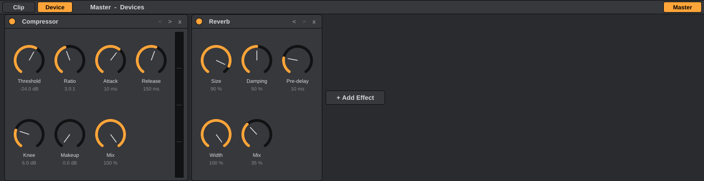

Bütün track'ler master kanalında toplanır. Sıra: **track'lerin toplamı → master efektleri →
master fader → seviye ölçer**. Metronom master fader'dan sonra eklenir, yani master seviyesinden
etkilenmez.

- Master efektlerine ulaşmak için alt paneldeki **Master** düğmesine bas ya da mikser
  görünümünde master şeridine tıkla.
- Master'a eklenen efektler bütün mix'e uygulanır. Örneğin master'daki bir compressor tek tek
  track'lere değil, toplam sese tepki verir.
- Master fader mikser görünümündedir (bkz. [Mikser](#17-mikser-görünümü)).

## 15. Otomasyon

Otomasyon, bir parametrenin zaman içinde nasıl değişeceğini çizmektir: örneğin filtreyi giderek
açmak ya da bir track'i yavaşça yükseltmek.

### Otomasyon şeridi

1. Track başlığındaki **A** düğmesine bas. Track'in altında bir otomasyon şeridi açılır.
2. Şeridin solundaki listeden otomatiklenecek parametreyi seç: **Volume**, **Pan** ve track'teki
   her cihazın her parametresi ("Synth: Filter cutoff", "Reverb: Mix", "Drum Rack: pad1Gain" gibi).
   Otomasyonu olan parametrelerin başında **•** vardır.
3. Şeritteki çizgi parametrenin değerini zamana göre gösterir. Nokta yoksa kesik çizgi
   parametrenin normal değerini gösterir ve "Click to add automation" yazar.

### Noktalarla çalışmak

| İşlem | Nasıl? |
| --- | --- |
| Nokta ekle | Şeritte boş bir yere tıkla. Tuşu bırakmadan sürükleyerek yerini ayarla |
| Taşı | Noktayı sürükle. Zaman ızgaraya yapışır (**Alt** serbest), komşu noktaları geçemez; **Shift** sadece değeri değiştirir |
| Sil | Noktaya **çift tıkla** ya da **sağ tıkla**; veya noktayı seçip **Delete** |
| Hepsini sil | Şeridin solundaki **x** düğmesi (o parametrenin bütün otomasyonu) |
| İptal | Sürüklerken **Escape** |

Noktalar arası değişim düz bir çizgidir; ilk noktadan önce ilk noktanın, son noktadan sonra son
noktanın değeri geçerlidir. Frekans gibi parametrelerde dikey eksen düğmedeki gibi logaritmiktir.
Sürüklerken değer yazıyla gösterilir.

### Otomasyonlu parametreler

- Otomasyonu olan bir düğme, sürgü ya da fader **kırmızıya döner** ve çalarken eğriyi takip
  ederek kendiliğinden hareket eder.
- Otomasyon çalma durmuşken de uygulanır: playhead'i bir yere götürünce parametre o noktadaki
  değeri alır.
- Otomasyonlu bir düğmeyi elle çevirirsen değer hemen tekrar eğriye döner. Elle değiştirmek
  istiyorsan önce otomasyonu sil.
- Otomasyon değerleri yaklaşık her 5 ms'de güncellenir; ani zıplamalar parametrelerin kendi
  yumuşatmasıyla tık sesi yapmadan uygulanır.
- Bir efekti silersen otomasyonu da silinir (geri alınca ikisi birlikte döner).

> Eklenti (VST3/LV2) parametreleri henüz otomatiklenemez.

## 16. Pattern modu (FL tarzı)

Pattern modu, üzerinde çalıştığın bir MIDI clip'i şarkının geri kalanından **bağımsız olarak,
tek başına döngüde** dinlemeni sağlar.

1. Bir MIDI clip'e çift tıklayıp piano roll'da aç.
2. Üst bardaki **PAT** düğmesine bas.
3. **Space** ile çal.

Pattern modunda:

- Sadece o clip'in track'i çalar, diğer track'ler susar.
- Çalma, clip'in başı ile sonu arasında döngüye girer.
- Konum çubuğu sadece clip'i gösterir ve **PATTERN** yazar.
- Piano roll'da notaları değiştirmek, Device sekmesinde synth'le oynamak döngüyü bozmaz.
- Clip'i taşırsan ya da uzatırsan döngü de onu takip eder.
- Başka bir MIDI clip'i açarsan pattern modu artık onu çalar.

**SONG** düğmesine basınca normal şarkı moduna dönülür. Açık bir MIDI clip yokken PAT'a basarsan
önce clip açman gerektiğini söyleyen bir uyarı çıkar.

## 17. Mikser görünümü

**Tab** ya da üst bardaki **Mixer** düğmesiyle mikser görünümüne geçilir. Her track için dikey bir
kanal şeridi vardır:

- **İsim**
- **Pan düğmesi:** C (orta), "37L", "50R" gibi değerler gösterir. Çift tık ortalar.
- **Aktivatör (track numarası)** ve **S (solo)**
- **Fader:** −60 dB (−inf) ile +6 dB arası; 0 dB fader yolunun yaklaşık dörtte üçündedir. Çift
  tık 0 dB'ye döndürür.
- **Seviye ölçer:** üst yarısı −12 ile +6 dB arasını gösterir (hassas bölge). Kırmızı tepe
  göstergesi tıklanınca sıfırlanır.

Sağda **Master** şeridi vardır (master fader ve ölçer). Master şeridine tıklamak master efektlerini
alt panelde açar. Mikserde yapılan her değişiklik geri alınabilir ve arrangement'taki track
başlıklarıyla eşzamanlıdır.

## 18. VST3 ve LV2 eklentileri

diyDaw, Linux'ta çalışan **VST3** ve **LV2** eklentilerini enstrüman ve efekt olarak yükleyebilir.

### Eklenti yöneticisi

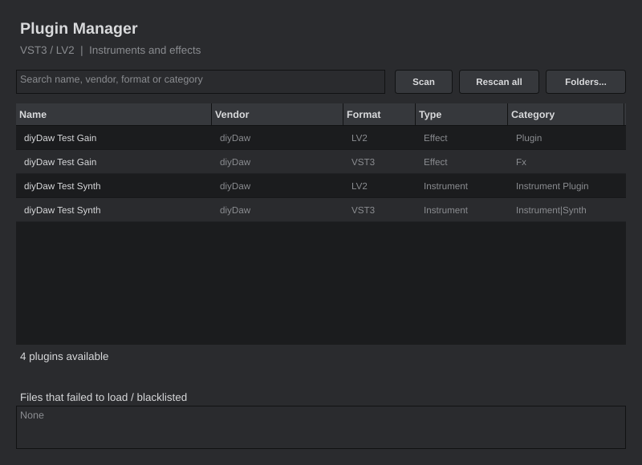

**File → Plugins...** ile açılır.

- **Scan:** standart klasörleri (`~/.vst3`, `/usr/lib/vst3`, `/usr/local/lib/vst3`, `~/.lv2`,
  `/usr/lib/lv2`, `/usr/local/lib/lv2` ...) ve eklediğin klasörleri tarar; daha önce taranmış
  dosyaları atlar.
- **Rescan all:** her şeyi baştan tarar.
- **Folders...:** ek arama klasörleri ekle/çıkar (uygulama ayarlarında saklanır).
- **Arama kutusu:** ada, üreticiye, formata veya kategoriye göre süzer.
- Altta yüklenemeyen ya da kara listeye alınmış dosyalar listelenir.

Tarama, arayüzü dondurmamak için dosya dosya yapılır. Bir eklenti tarama sırasında programı
çökertirse, bir sonraki açılışta o eklenti **otomatik olarak kara listeye** alınır. Taranan liste
`~/.config/diyDaw/plugins.xml` dosyasında saklanır, yani her açılışta yeniden taramak gerekmez.
Liste boşsa program kendiliğinden tarama yapmaz; ilk seferde **Scan**'e basman gerekir.

### Eklenti eklemek

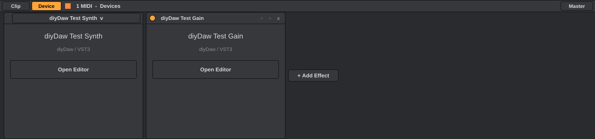

- **Efekt:** Device sekmesinde **+ Add Effect → Plugins → (üretici) → (eklenti)**.
- **Enstrüman:** MIDI track'in ilk cihazının başlığındaki açılır menüden **Plugins → ...**
  seç. Mevcut enstrüman (synth, drum rack ya da başka bir eklenti) bununla değiştirilir. Aynı
  menüden **Synth** ya da **Drum Rack**'e geri dönebilirsin.
- Eklenti panelinde adı, üreticisi ve formatı yazar. **Open Editor** eklentinin kendi arayüzünü
  ayrı bir pencerede açar. Pencere zaten açıksa öne getirilir; eklenti silinince pencere de
  kapanır.

### Eklentiler ve proje dosyası

- Eklentinin bütün ayarları (kendi içindeki "state") projeyle birlikte kaydedilir ve export'a
  dahil edilir.
- Eklentiyi silip **Ctrl+Z** yaparsan ayarlarıyla birlikte geri gelir.
- Eklentinin kendi arayüzünde bir şey değiştirirsen proje "kaydedilmemiş" olarak işaretlenir.
- Proje başka bir bilgisayarda açılırsa ve eklenti orada kurulu değilse proje yine açılır; o cihaz
  kırmızı **Missing: ...** yazısıyla sessiz kalır. Eklenti kurulup proje yeniden açılınca ayarlarıyla
  geri gelir.

### Linux için önerilen ücretsiz eklentiler

| Eklenti | Tür | Nasıl kurulur? |
| --- | --- | --- |
| Surge XT | Synth | surge-synthesizer.github.io (deb paketi) |
| Vital | Synth (wavetable) | vital.audio |
| LSP Plugins | EQ, compressor, limiter, ... | `sudo apt install lsp-plugins-lv2` |
| Dragonfly Reverb | Reverb | `sudo apt install dragonfly-reverb-lv2` |
| x42-plugins | Ölçüm, EQ, araçlar | `sudo apt install x42-plugins` |

### Test eklentileri

Projenin kendisi, eklenti barındırmayı denemek için iki küçük eklenti derler: **diyDaw Test Gain**
(sesi kısan/açan efekt) ve **diyDaw Test Synth** (her notaya bir sinüs çalan enstrüman). Hem VST3
hem LV2 olarak `build/tests/plugins` klasörüne derlenirler. Denemek için eklenti yöneticisinde
**Folders...** ile bu klasörü ekleyip **Scan**'e bas.

### Eklenti sınırları

- Eklenti parametreleri henüz otomatiklenemiyor.
- Eklenti gecikme telafisi (latency compensation) yok; gecikmesi yüksek eklentiler (lookahead'li
  limiter gibi) diğer track'lere göre hafif geç kalabilir.
- LV2'de bir parametre değişikliği, ses motorunun işlediği bir sonraki küçük blokla (birkaç
  milisaniye) eklentiye geçer; pratikte fark edilmez.
- Sadece Linux'ta çalışan eklentiler desteklenir; Windows eklentileri için yabridge gibi
  köprüler gerekir (henüz denenmedi).

## 19. Projeler: kaydetme, açma, dosyalar

**File** menüsü:

| Komut | Kısayol | Açıklama |
| --- | --- | --- |
| New Project | Ctrl+N | 2 MIDI + 2 audio track'li boş proje |
| Open... | Ctrl+O | `.diydaw` dosyası aç |
| Save | Ctrl+S | Kaydet (ilk seferde dosya adı sorar) |
| Save As... | Ctrl+Shift+S | Farklı kaydet |
| Export Audio... | Ctrl+Shift+R | WAV olarak dışa aktar |
| Plugins... | | Eklenti yöneticisi |

- Kaydedilmemiş değişiklik varken yeni proje açarken, başka bir proje açarken ya da programı
  kapatırken **Save / Don't Save / Cancel** diye sorulur.
- Varsayılan proje klasörü `~/Music/diyDaw`'dır.
- Bir `.diydaw` dosyasına çift tıklayarak ya da komut satırında `diyDaw proje.diydaw` yazarak da
  proje açılabilir (çift tıklama için masaüstü kaydı gerekir; bkz.
  [Sorun giderme](#25-sorun-giderme)).

### Ses dosyaları nerede saklanır?

Proje dosyası ses dosyalarını **kopyalamaz**, onlara bağlantı tutar. Her bağlantı için hem tam yol
hem de proje dosyasına göre **göreli yol** saklanır. Açarken önce tam yol denenir; bulunamazsa
göreli yol denenir. Bu sayede:

- Ses dosyalarını proje dosyasının yanında (veya alt klasöründe) tutarsan, bütün klasörü başka bir
  yere ya da başka bir bilgisayara taşıyabilirsin.
- Ses dosyasını silersen ya da tek başına taşırsan clip **Missing file** olarak görünür.

Drum rack pad'lerine yüklediğin sample'lar da aynı şekilde saklanır. Hazır kit sesleri dosya
değildir, her zaman bulunur.

Dosya formatının ayrıntıları için [dosya-formati.md](dosya-formati.md) belgesine bak.

## 20. Ses olarak dışa aktarma (export)

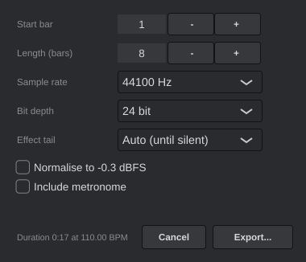

**File → Export Audio...** (Ctrl+Shift+R):

| Seçenek | Açıklama |
| --- | --- |
| Start bar | Export'un başladığı bar |
| Length (bars) | Kaç bar dışa aktarılacağı. Varsayılan: şarkının tamamı (son clip'in bittiği bara kadar) |
| Sample rate | 44,1 / 48 / 88,2 / 96 kHz |
| Bit depth | 16 bit (TPDF dither ile), 24 bit, 32 bit float |
| Effect tail | **Off**, **Auto (until silent)** (varsayılan), ya da sabit 1 / 2 / 4 / 8 saniye |
| Normalise to −0.3 dBFS | En yüksek tepe −0,3 dBFS olacak şekilde seviyeyi ayarlar |
| Include metronome | Metronomu da kayda kat |

Altta export'un süresi yazar. **Export...** dosya adını sorar ve render'ı arka planda başlatır;
bir ilerleme penceresi açılır ve istediğin an iptal edebilirsin.

Nasıl çalışır?

- Export, projenin bir **kopyası** üzerinde, ses kartından bağımsız ayrı bir ses motoruyla yapılır.
  Bu yüzden export sürerken şarkıyı çalmaya ve düzenlemeye devam edebilirsin.
- Gerçek zamandan çok daha hızlıdır (birkaç dakikalık şarkı birkaç saniyede biter).
- **Effect tail:** aralığın sonunda çalma durdurulur (notalar bırakılır, clip'ler biter) ama
  reverb ve delay sönene kadar render devam eder. "Auto" modunda ses 250 ms boyunca −90 dB'nin
  altında kalınca durur; en fazla 10 saniye.
- Yarım kalan ya da iptal edilen bir export hedef dosyayı bozmaz: önce geçici bir dosyaya yazılır,
  bitince yerine konur.

Komut satırından da export edilebilir (otomatik kuyrukla, 44,1 kHz / 24 bit):

```bash
diyDaw --export cikti.wav proje.diydaw
```

## 21. Ses ayarları

**Audio...** düğmesi ses kartı ayarlarını açar: çıkış cihazı, sample rate ve buffer boyutu.

- Linux'ta varsayılan olarak **ALSA** kullanılır. PipeWire kullanan sistemlerde ALSA üzerinden
  PipeWire'a bağlanır ve ek ayar gerekmez.
- JACK sunucusu çalışıyorsa JACK da seçilebilir. Çalışmıyorsa programın terminal çıktısında
  "Cannot connect to server socket" uyarıları görünür; bunlar zararsızdır.
- **Buffer boyutu** küçüldükçe gecikme azalır ama işlemci yükü artar. 256–512 sample iyi bir
  başlangıçtır.
- Ses kartı hiç açılamazsa arayüz yine çalışır; bu pencereden başka bir cihaz seçebilirsin.

## 22. Geri alma (undo) nasıl çalışır?

- **Ctrl+Z** geri al, **Ctrl+Shift+Z** veya **Ctrl+Y** yinele.
- Her **kullanıcı hareketi** tek bir adımdır: bir fader'ı sürüklemek (kaç kez değer değişirse
  değişsin), bir clip'i taşımak, bir sürüklemede birden fazla nota silmek gibi.
- Geri alınabilenler: clip ve nota düzenlemeleri, track adı, volume/pan/mute/solo, tempo, master
  seviyesi, synth ve drum rack parametreleri, efekt ekleme/silme/sıralama/açma-kapama/parametreler,
  enstrüman değiştirme, otomasyon noktaları, drum pad sample'ları.
- Geri alınamayanlar: track ekleme, track yüksekliği, eklentilerin kendi arayüzünde yapılan
  değişiklikler (bunlar eklentinin içinde kalır ama projeyle kaydedilir).
- Proje açınca ya da yeni proje oluşturunca geri alma geçmişi temizlenir.

## 23. Pencere düzeni ve kalıcı ayarlar

Sabit kalanlar: üst bar ve konum çubuğu. Sürüklenebilenler: alt panel yüksekliği, track başlık
sütunu genişliği, track yükseklikleri.

Ayarlar `~/.config/diyDaw/` klasöründe saklanır:

| Dosya | İçerik |
| --- | --- |
| `diyDaw.settings` | Alt panel yüksekliği ve kapalı/açık durumu, başlık sütunu genişliği, eklenti klasörleri |
| `plugins.xml` | Taranmış eklentilerin listesi |
| `plugin-scan-in-progress.txt` | Tarama sırasında çöken eklentileri yakalamak için kullanılan yardımcı dosya |

Bu klasörü silmek bütün ayarları sıfırlar (projelere dokunmaz).

## 24. Örnek bir çalışma akışı

Boş bir projeden kısa bir loop yapmak:

1. **Ctrl+N** ile yeni proje aç. Tempoyu BPM kutusunda 124'e çek.
2. **+ Drums** ile bir drum track ekle. Track'te boş bir yere çift tıkla: 1 barlık bir clip açılır.
3. Piano roll'da Kick satırına her vuruşa (1, 2, 3, 4) bir nota çift tıkla. Snare'e 2 ve 4'e,
   Closed Hat'e sekizliklere nota koy.
4. **PAT**'a bas ve **Space** ile çal; davul döngüde çalar. Velocity şeridinde hi-hat'leri
   değişken yap.
5. **+ MIDI** ile bir synth track'i ekle, bir clip oluştur ve basit bir bas çiz. Device sekmesinde
   synth'i bas sesi yap (Osc 2 Semi −12, Cutoff düşük).
6. **SONG**'a dön. Clip'leri **Ctrl+D** ile çoğaltarak 8 bara uzat.
7. Synth track'ine **+ Add Effect → Delay**, master'a **Compressor** ekle.
8. Synth track'inde **A**'ya bas, "Synth: Filter cutoff"u seç ve 8 bar boyunca yükselen bir eğri
   çiz.
9. **Ctrl+S** ile kaydet, **Ctrl+Shift+R** ile WAV olarak dışa aktar.

Hazır örnekleri incelemek için `examples/midi-demo.diydaw` (synth, efektler, otomasyon) ve
`examples/drums-demo.diydaw` (drum rack) dosyalarını aç.

## 25. Sorun giderme

| Belirti | Çözüm |
| --- | --- |
| Hiç ses yok | **Audio...** ile doğru çıkış cihazını seç; master fader'ı ve track aktivatörlerini kontrol et; bir track solo'da mı bak |
| `.diydaw` dosyası çift tıklayınca tarayıcıda açılıyor | Dosya içi XML olduğu için sistem onu XML sanıyor. `~/.local/share/mime/packages/` altına diyDaw MIME tanımı ve `~/.local/share/applications/diydaw.desktop` eklenmeli (bkz. [gelistirme.md](gelistirme.md#masaüstü-entegrasyonu)) |
| Clip'te "Missing file" | Ses dosyası taşınmış/silinmiş. Dosyayı eski yerine ya da proje dosyasına göre aynı göreli yere koy ve projeyi yeniden aç |
| Clip'te "Loading..." hiç bitmiyor | Dosya bozuk ya da desteklenmeyen bir format olabilir |
| Eklenti listede yok | **Scan**'e bas; eklentinin klasörü standart yerlerden değilse **Folders...** ile ekle; kara listede mi diye alttaki listeye bak |
| Eklenti "Missing" | Eklenti bu bilgisayarda kurulu değil ya da yüklenemedi; hata mesajı panelde yazar |
| Bilgisayar klavyesi nota çalmıyor | Bir MIDI track seçili mi? Ctrl/Alt/Shift basılı mı? Bir yazı kutusu (örneğin track adı) düzenleniyor mu? |
| Terminalde "Cannot connect to server socket" | JACK sunucusu yok; zararsızdır, ses ALSA/PipeWire üzerinden çalışır |
| Bir nota asılı kaldı | Space ile durdurup yeniden başlatmak bütün notaları keser |

## Bilinen sınırlar

- **Warp yok:** ses clip'leri tempoya uydurulmaz, kendi hızında çalar.
- **Ses kaydı yok:** mikrofon/line girişinden kayıt yapılamaz; canlı çalınan MIDI notaları
  kaydedilmez.
- **Otomasyon kaydı yok:** otomasyon sadece çizilerek oluşturulur; otomasyonlu bir parametreyi
  elle geçici olarak geçersiz kılma (Ableton'daki "re-enable automation") yok; noktalar arası
  sadece düz çizgi.
- **Eklentiler:** parametreleri otomatiklenemez, gecikme telafisi yok.
- **Clip editörü:** ses clip'leri için editör yok (sadece arrangement'ta kırpma/bölme).
- **Seçim:** arrangement'ta aynı anda tek clip seçilebilir.
- **Track sayısı:** en fazla 16 track; track silme ve sıralama henüz yok.
- **Session view** (Ableton'ın clip başlatma ızgarası) henüz yok.
- **Ölçü:** zaman imzası proje dosyasında var ama arayüzden değiştirilemiyor (4/4).
