🇬🇧 English | 🇹🇷 [Türkçe](tr/kullanim-kilavuzu.md)

# diyDaw User Guide

This guide walks through everything you need when first opening diyDaw, from the top of the
window to the bottom. All shortcuts are also listed in [shortcuts.md](shortcuts.md).

**Contents**

1. [Basic concepts](#1-basic-concepts)
2. [Window layout](#2-window-layout)
3. [Top bar (transport)](#3-top-bar-transport)
4. [Position bar](#4-position-bar)
5. [Tracks](#5-tracks)
6. [Arrangement: working with clips](#6-arrangement-working-with-clips)
7. [Audio files and audio clips](#7-audio-files-and-audio-clips)
8. [MIDI clips and the piano roll](#8-midi-clips-and-the-piano-roll)
9. [Live playing: computer keyboard and MIDI keyboard](#9-live-playing-computer-keyboard-and-midi-keyboard)
10. [Bottom panel: Clip and Device tabs](#10-bottom-panel-clip-and-device-tabs)
11. [Synth](#11-synth)
12. [Drum rack](#12-drum-rack)
13. [Effects](#13-effects)
14. [Master channel](#14-master-channel)
15. [Automation](#15-automation)
16. [Pattern mode (FL-style)](#16-pattern-mode-fl-style)
17. [Mixer view](#17-mixer-view)
18. [VST3 and LV2 plugins](#18-vst3-and-lv2-plugins)
19. [Projects: saving, opening, and files](#19-projects-saving-opening-and-files)
20. [Exporting audio](#20-exporting-audio)
21. [Audio settings](#21-audio-settings)
22. [How undo works](#22-how-undo-works)
23. [Window layout and persistent settings](#23-window-layout-and-persistent-settings)
24. [Example workflow](#24-example-workflow)
25. [Troubleshooting](#25-troubleshooting)
26. [Known limitations](#known-limitations)

---

## 1. Basic concepts

A diyDaw music project consists of:

- **Track:** a horizontal lane on the timeline. There are two types:
  - **Audio track:** plays *audio clips* from audio files.
  - **MIDI track:** plays *MIDI clips* containing notes. An **instrument** converts notes to
    sound: the built-in synth, drum rack, or a VST3/LV2 plugin. A “drum track” is a MIDI track
    whose instrument is a drum rack.
- **Clip:** a region on a track with a defined start and end. A clip can **loop**, repeating
  its content throughout its length.
- **Device:** an element in a track's signal chain: the instrument first on MIDI tracks, then
  effects in order. The effects feed the track's fader and pan.
- **Master:** the final channel where all tracks are summed, with its own effect chain and fader.
- **Beat and bar:** time is measured in beats (quarter notes). The default time signature is
  4/4: 1 bar = 4 beats. A position display of `3.2.1` means “bar 3, beat 2, sixteenth note 1.”
- **Tempo (BPM):** beats per minute. MIDI clips follow tempo changes, while audio clips keep
  playing at **their own speed**. Warping is not yet available; see
  [Known limitations](#known-limitations).

## 2. Window layout

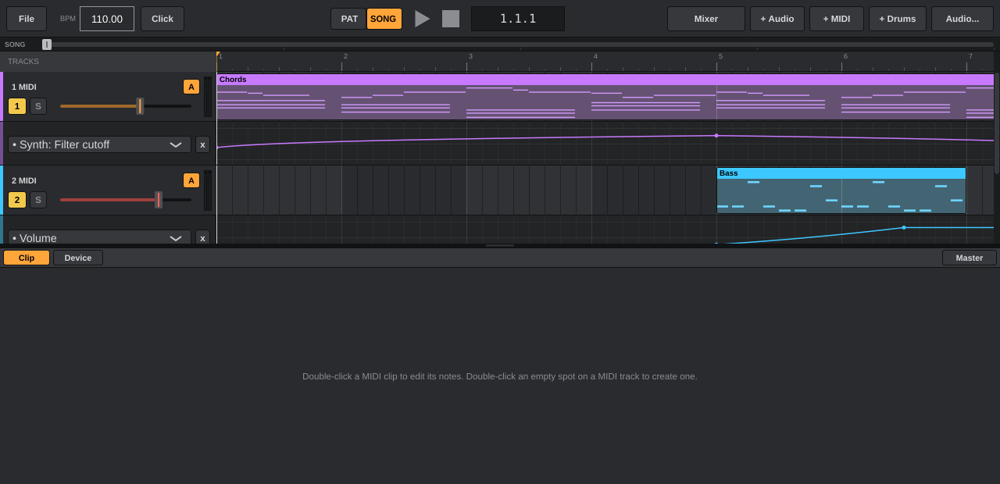

From top to bottom:

1. **Top bar (transport):** file menu, tempo, metronome, Pattern/Song, play/stop, position, view,
   and add-track buttons.
2. **Position bar:** a thin overview of the whole song. Drag it to navigate through the song.
3. **Main area:** Arrangement (timeline) or Mixer. Switch between them with **Tab**.
4. **Divider:** the thin bar between the main area and bottom panel. Drag to resize the bottom
   panel; double-click to close or open it.
5. **Bottom panel (detail view):** the selected clip's editor (piano roll) or selected track's
   device chain.

The window title shows the project name. Unsaved changes add `*` after the name, for example
`My Song* - diyDaw`.

## 3. Top bar (transport)

From left to right:

| Item | Function |
| --- | --- |
| **File** | New project, open, save, save as, export audio, Plugin Manager |
| **BPM** | Tempo. Drag vertically over the box to change it; double-click to reset to 120. Tempo changes are undoable and stored as a project setting, not automation |
| **Click** | Toggle the metronome. Bar starts use a higher-pitched click. The export dialog controls whether it is included in exports |
| **PAT / SONG** | Playback mode. SONG plays the whole song; PAT loops only the clip open in the piano roll (see [Pattern mode](#16-pattern-mode-fl-style)) |
| **▶ (Play)** | Start playback. In Pattern mode, starts at the clip's beginning if the current position is outside it |
| **■ (Stop)** | First press stops. Press again while stopped to return to the start (clip start in Pattern mode) |
| **Position display** | Playback position as `bar.beat.sixteenth` |
| **Mixer / Arrangement** | Switch between Mixer and Arrangement, like Tab |
| **+ Audio** | New audio track (Ctrl+T) |
| **+ MIDI** | New MIDI track with synth (Ctrl+Shift+T) |
| **+ Drums** | New drum track with a drum rack and built-in kit (Ctrl+Alt+T) |
| **Audio...** | Audio device settings (see [Audio settings](#21-audio-settings)) |

**Space** is the quickest way to start and stop playback.

## 4. Position bar

The thin bar below the transport corresponds to FL Studio's song position bar.

- The label on the left reads **SONG** or **PATTERN**.
- It spans the whole song, ending one bar after the bar where the last clip ends, and fills
  as playback progresses.
- **Click:** jump to that position.
- **Drag:** scrub, making the position follow the pointer. Positions snap to sixteenth notes;
  hold **Alt** to move freely.
- In Pattern mode, it shows only the clip's length.

## 5. Tracks

### Adding tracks

- **+ Audio** / **Ctrl+T**: audio track.
- **+ MIDI** / **Ctrl+Shift+T**: MIDI track with the built-in synth.
- **+ Drums** / **Ctrl+Alt+T**: drum rack track with the built-in kit loaded.
- Dropping an audio file in the empty area below all arrangement tracks also creates an audio track.

A new project starts with 2 MIDI and 2 audio tracks. A project supports up to **16 tracks**.

### Track header

Each track has a header on the left:

- **Color strip:** the track color, also used for its clips.
- **Name:** double-click to rename (undoable).
- **Yellow numbered button (activator):** lit means audible; turn it off to mute the track.
  This follows Ableton's track activator behavior.
- **S (solo):** only soloed tracks are heard. Multiple tracks can be soloed.
- **Horizontal slider:** track level, from −60 dB to +6 dB; double-click to reset to 0 dB.
- **A:** show / hide the automation lane (see [Automation](#15-automation)).
- **Level meter:** the track's current output level.

### Track height and header width

- Drag a track's **bottom edge** vertically, in the thin region near the edge of either its
  header or clip area, to resize it (40–320 pixels). **Double-click** the edge to restore the
  default 64-pixel height. Heights are saved with the project.
- Drag the **vertical boundary** between track headers and the timeline horizontally to resize
  the header column (140–360 pixels). This width is stored as an application setting.
- Short track headers show only the name and buttons, hiding the slider and meter.

### Selecting a track

Click a track's clip area to select it. The selected track:

- appears in the bottom panel's **Device** tab;
- receives **live notes** from the computer keyboard and MIDI keyboard if it is a MIDI track.

## 6. Arrangement: working with clips

### Time ruler and playhead

- The **time ruler** above the arrangement shows bar numbers.
- **Click** it to move playback to that position, snapped to the grid; hold Alt to move freely.
- **Drag vertically** on the ruler to zoom.
- The thin vertical line is the **playhead**, showing the playback position. During playback,
  the view follows in pages when it leaves the visible area.
- Clicking empty track space also moves the playhead there and clears clip selection.

### Zooming and scrolling

| Gesture | Result |
| --- | --- |
| **Ctrl + wheel** | Zoom around the pointer |
| **Wheel** | Scroll vertically if tracks do not fit; otherwise scroll in time |
| **Shift + wheel** / horizontal touchpad scrolling | Scroll in time |
| Drag vertically on the ruler | Zoom |

Grid spacing adapts to the zoom level, from sixteenth notes to bars. Bar lines are brighter.

### Selecting and editing clips

| Action | How |
| --- | --- |
| Select | Click a clip; one clip can be selected at a time |
| Move | Drag the clip's body. Snaps to the grid; **Alt** disables snapping. You can move to another track of the same type (audio → audio, MIDI → MIDI) |
| Trim start / end | Move within about 6 pixels of the left or right edge; drag when the cursor changes to ↔ |
| Delete | **Delete** or **Backspace** |
| Duplicate | **Ctrl+D** places the copy at the clip's end |
| Split | Place the playhead inside the clip and press **Ctrl+E** |
| Toggle looping | **Ctrl+L** |
| Cancel a drag | **Escape** while dragging |
| Open (MIDI) | Double-click the clip to open the piano roll in the bottom panel |
| New MIDI clip | Double-click empty space on a MIDI track to create and open a one-bar, empty, looping clip at that bar |

While dragging, a translucent ghost shows the clip's new position. Releasing the mouse commits
the change as one undo step.

### Overlap rule (Ableton-style)

Clips on the same track never overlap. Moving, extending, duplicating, or adding a clip over
another clip **cuts the underlying clip**:

- fully covered clips are deleted;
- a covered end is trimmed;
- a covered middle splits the clip in two.

One Ctrl+Z undoes the entire operation.

### Looping clips

- **Looping audio clips** can be extended as far as you want by dragging the right edge; the
  audio file repeats from the start. Without looping, an audio clip cannot be longer than
  its source file.
- **Looping MIDI clips** repeat their content every *loop length*. Change this with the orange
  marker on the piano-roll ruler (see [Piano roll](#8-midi-clips-and-the-piano-roll)). New MIDI
  clips have looping enabled.
- Trimming a clip's **left edge** leaves the content in place and changes only the visible
  window. Looping clips can also extend to the left, repeating the content backward in time.

## 7. Audio files and audio clips

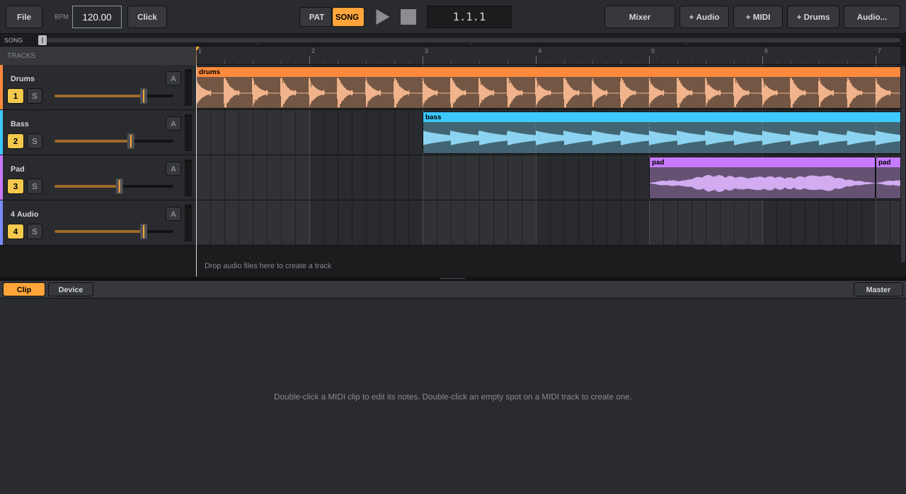

- **Drag and drop** one or more audio files from your file manager onto an audio track.
  Supported formats are WAV, AIFF, FLAC, and OGG Vorbis; MP3 is not yet supported. The clip is
  placed at the drop position, snapped to the grid. Multiple files are arranged consecutively.
- Dropping below all tracks creates a new audio track. Dropping onto a MIDI track also creates
  a new audio track.
- Files load in the background. Large files show **Loading...** in the clip while the UI stays
  responsive.
- A waveform is drawn inside the clip.
- If a file is missing because it was moved or deleted, the clip shows **Missing file** in red
  and stays silent.
- Very short 2 ms fades at clip starts and ends prevent clicks at edit points.
- Files are limited to 10 minutes and must be mono or stereo.

**Tempo and audio clips:** audio always plays at its natural speed. When you add a clip, its
length is converted to beats at the current tempo. Changing tempo later leaves its grid
length unchanged, while the sound keeps its original speed, so it may drift from the grid.

## 8. MIDI clips and the piano roll

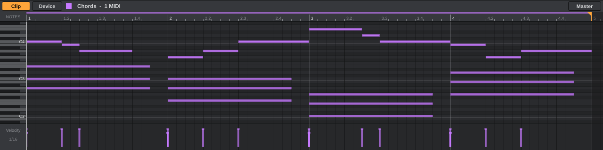

Double-click a MIDI clip to open the piano roll in the bottom panel's **Clip** tab.

### Parts of the piano roll

- **Left: keyboard.** Each row is a note; C notes are labeled (**C3 = MIDI 60**, middle C).
  Click a key to preview its note. Drum tracks show pad names instead of a keyboard.
- **Top: ruler.** Bar and beat numbers use the clip's *content time*, starting at 1. The orange
  marker on the right is the **loop end**. The area outside the loop is darker.
- **Middle: note grid.** Notes are rectangles in the track color, with opacity indicating
  velocity. Selected notes are brighter and outlined.
- **Bottom: velocity lane.** Each note's velocity (strike strength) is shown as a vertical bar.
  The bottom-left label shows the current grid resolution, such as `1/16`.

### Working with notes

| Action | How |
| --- | --- |
| Add a note | **Double-click** empty space. The note is one grid step long; keep the button held and drag to adjust its position |
| Select | Click a note. **Shift** or **Ctrl** + click adds it to / removes it from the selection |
| Select several | Drag from empty space to draw a selection rectangle |
| Select all | **Ctrl+A** |
| Move | Drag selected notes: horizontally in time (grid-snapped, **Alt** disables snapping), vertically in pitch |
| Resize | Drag a note's right edge; all selected notes resize together |
| Delete | **Delete** / **Backspace**, or **right-click** a note |
| Eraser | **Hold the right button** and drag across notes to delete them, as in FL Studio. One Ctrl+Z restores all notes deleted in the gesture |
| Duplicate | **Ctrl+D** copies the selection immediately after itself |
| Transpose | **↑ / ↓** by a semitone; **Shift + ↑ / ↓** by an octave |
| Move in time | **← / →** by one grid step |
| Velocity | Drag a note's bar vertically in the velocity lane; selected notes change together |
| Loop length | Drag the orange loop-end marker on the ruler |
| Playback position | Click or drag the ruler to move the playhead there |
| Cancel | **Escape** while dragging |

Adding and moving notes previews their sound to help you find the right pitch.

### Navigation

| Gesture | Result |
| --- | --- |
| **Wheel** | Scroll up / down in pitch |
| **Shift + wheel** | Scroll in time |
| **Ctrl + wheel** | Zoom in time |
| **Alt + wheel** (or **Ctrl + Shift + wheel**) | Make keys and notes taller / shorter (vertical zoom, FL style) |
| **−** / **+** in the top-left corner | Same, around the middle of the view |
| Drag the keyboard's right edge | Make the keyboard wider / narrower |

### Key and note size

Like in FL Studio, the size of the keys and notes is adjustable, so notes stay easy to hit:

- **Row height** (one key / one note row) goes from 6 to 40 pixels (default 12). Use
  **Alt + wheel** over the keyboard or the grid: the pitch under the mouse stays in place. The
  **−** / **+** buttons above the keyboard do the same with the mouse. Some desktops reserve
  Alt + wheel; **Ctrl + Shift + wheel** works too.
- **Keyboard width** goes from 40 to 200 pixels (default 56): drag the line between the keyboard
  and the notes (the cursor turns into ↔).
- With tall rows every white key is named (D3, E3, ...), not only the C notes, and pad names on
  drum tracks get a larger font. Note blocks show their name (pitch, or pad name on drum tracks)
  when it fits inside the note.
- Both sizes apply to every clip and are remembered between sessions (app settings).

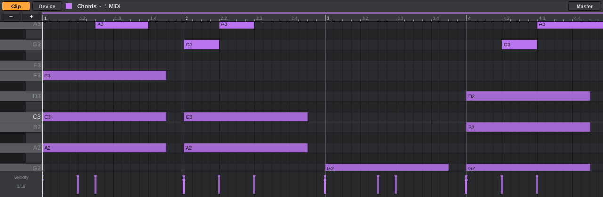

Opening the piano roll centers the notes and fits the whole loop. During playback, it also
shows the playhead, wrapping in content time for looping clips.

## 9. Live playing: computer keyboard and MIDI keyboard

You can play the selected track live if it is a MIDI track.

### Computer keyboard (Ableton layout)

```
  W E   T Y U   O P        ← black keys
 A S D F G H J K L ;       ← white keys
 C D E F G A B C D E
```

| Key | Action |
| --- | --- |
| `A S D F G H J K L ;` | White keys starting at C |
| `W E T Y U O P` | Black keys |
| `Z` / `X` | One octave down / up (initially A plays C3 = MIDI 60) |
| `C` / `V` | Decrease / increase velocity by 0.1 (initially 0.8) |

Notes stop when you release the key. These keys work only with a MIDI track selected and
**Ctrl, Alt, and Shift released**. On drum tracks, A plays C3; press Z twice to reach the kick
at C1.

### MIDI keyboard

All connected MIDI input devices open automatically and play the **selected MIDI track**, like
Ableton's auto-arm behavior. Note-on, note-off, and “all notes off” messages are supported.

> Live notes are currently for monitoring only; they are not recorded.

## 10. Bottom panel: Clip and Device tabs

The bottom panel's top strip contains:

- **Clip:** editor for the selected / open clip. MIDI clips use the piano roll; audio clips do
  not yet have an editor.
- **Device:** the selected track's device chain (instrument + effects).
- In the center: the open clip or track's name and color.
- On the right: **Master**, which opens the master channel's effect chain.

**Shift+Tab** switches between the tabs. Drag the divider above the panel to resize it;
double-click the divider to close or reopen it.

If the device chain is wider than the window, a horizontal scrollbar appears below it.

## 11. Synth

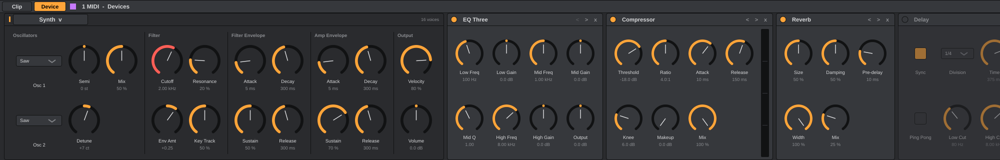

Every new MIDI track comes with a built-in 16-voice subtractive synth, capable of playing
16 notes at once. Signal flow: **two oscillators → mixer → resonant low-pass filter → amplitude
envelope → output**.

| Section | Parameter | Range (default) | Description |
| --- | --- | --- | --- |
| Oscillators | Osc 1 / Osc 2 | Saw, Square, Triangle, Sine (Saw) | Waveform. Saw and square use band-limited generation to avoid aliasing artifacts |
| | Semi | −24 … +24 semitones (0) | Osc 2 pitch |
| | Detune | −50 … +50 cents (+7) | Osc 2 fine tuning; slight detuning thickens the sound |
| | Mix | 0% … 100% (50%) | 0% is Osc 1 only; 100% is Osc 2 only |
| Filter | Cutoff | 20 Hz … 20 kHz (2 kHz) | Filter cutoff frequency |
| | Resonance | 0% … 100% (20%) | Emphasis at the cutoff; near 100% produces a whistle-like sound |
| | Env Amt | −1 … +1 (+0.25) | How far the filter envelope opens the cutoff (±6 octaves) |
| | Key Track | 0% … 100% (50%) | Raises cutoff with note pitch |
| Filter Envelope | Attack / Decay / Sustain / Release | 1 ms … 10 s; sustain 0% … 100% | Filter movement over time |
| Amp Envelope | Attack / Decay / Sustain / Release | 5 ms / 300 ms / 70% / 300 ms | Amplitude over time |
| Output | Velocity | 0% … 100% (80%) | How strongly velocity affects the sound |
| | Volume | −60 … +6 dB (0 dB) | Synth output level |

Tips:

- **Pad:** raise Attack and Release above 500 ms and lower Cutoff to around 1 kHz.
- **Bass:** Osc 2 Semi = −12, low Cutoff, Resonance 30–40%, Env Amt +0.5, short Decay.
- **Pluck:** Sustain 0%, Decay 150–300 ms, high Env Amt.
- Double-click any knob to restore its default. Values appear in a tooltip while dragging,
  and each knob gesture is one undo step.

To replace the synth, choose **Drum Rack** or a **plugin** from the drop-down in its header
(see [Plugins](#18-vst3-and-lv2-plugins)).

## 12. Drum rack

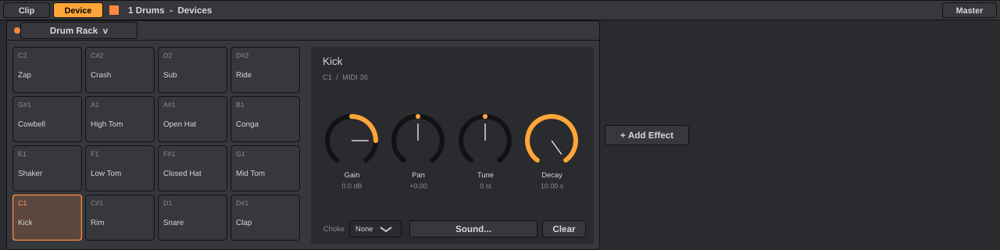

The drum rack maps notes to 16 **pads** that play samples (recorded sounds). Tracks created
with **+ Drums** come with a built-in kit.

### Pad layout

Pads start at the **bottom left**, as in Ableton: the bottom-left pad is **C1 (MIDI 36)** and
the top-right is **D#2 (MIDI 51)**. The built-in kit roughly follows General MIDI order:

| Note | Pad | | Note | Pad |
| --- | --- | --- | --- | --- |
| C1 (36) | Kick | | G#1 (44) | Cowbell |
| C#1 (37) | Rim | | A1 (45) | High Tom |
| D1 (38) | Snare | | A#1 (46) | Open Hat |
| D#1 (39) | Clap | | B1 (47) | Conga |
| E1 (40) | Shaker | | C2 (48) | Zap |
| F1 (41) | Low Tom | | C#2 (49) | Crash |
| F#1 (42) | Closed Hat | | D2 (50) | Sub (808-style bass) |
| G1 (43) | Mid Tom | | D#2 (51) | Ride |

The built-in kit uses no external sample files. Its sounds are **synthesized** in code when
needed, using classic drum-machine techniques. This avoids external sample licensing concerns
and keeps project files small.

### Working with pads

- **Click a pad:** select it and preview its sound.
- **Load a sample:** drop an audio file from the file manager onto a pad. Multiple files fill
  consecutive pads.
- **Sound...:** choose another built-in kit sound for the selected pad.
- **Clear:** empty the pad.

The controls on the right apply to the **selected pad**:

| Control | Range (default) | Description |
| --- | --- | --- |
| Gain | −60 … +6 dB (0 dB) | Pad level |
| Pan | Left … Right (center) | Stereo position |
| Tune | −24 … +24 semitones (0) | Pitch, changed by speeding up / slowing down the sample; higher pitch shortens it |
| Decay | 10 ms … 10 s (10 s) | How quickly the sound fades. At 10 s, the sample plays to its end |
| Choke | None, 1 … 8 (None) | Pads in the same choke group cut each other off. The built-in closed and open hi-hats share a group, so a closed hi-hat cuts off the open hi-hat |

Pads are **one-shot**: releasing a note does not stop the sound. It plays until the sample
ends or decays. Velocity scales the level linearly. Up to 32 voices can sound at once;
additional voices gently cut off the oldest.

### Piano roll on drum tracks

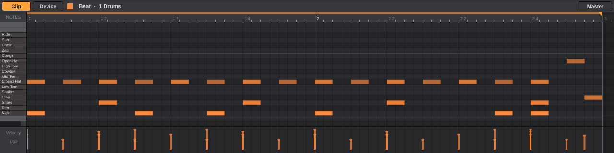

On drum tracks, the piano-roll keyboard displays **pad names** (Kick, Snare, Closed Hat, ...)
instead of note names, and opens around the pad range. Note length does not matter; only
start time and velocity do.

Pad parameters (gain, pan, tune, decay, choke) can also be automated.

## 13. Effects

Every track, audio or MIDI, and the master has an **effect chain**. Effects process from left
to right, after the instrument and before the track fader.

- **Add:** use **+ Add Effect** at the end of the chain in the Device tab. The menu lists
  built-in effects, a **Plugins** submenu, and **Manage plugins...**.
- **Enable / disable (bypass):** use the round button in the effect header. Disabled effects
  look dimmed. A roughly 10 ms crossfade prevents clicks when toggling bypass.
- **Reorder:** use **<** and **>** in the header.
- **Delete:** use **x** in the header.

All these operations are undoable and saved with the project.

### EQ Three

A three-band equalizer with a low shelf, mid peak, and high shelf.

| Parameter | Range (default) |
| --- | --- |
| Low Freq / Low Gain | 20–1000 Hz (100 Hz) / −18…+18 dB (0) |
| Mid Freq / Mid Gain / Mid Q | 100 Hz–10 kHz (1 kHz) / −18…+18 dB (0) / 0.3–8 (1) |
| High Freq / High Gain | 1–20 kHz (8 kHz) / −18…+18 dB (0) |
| Output | −18…+18 dB (0) |

With every gain at 0 dB, the EQ leaves the sound unchanged.

### Compressor

Reduces dynamic range by attenuating loud passages. Both channels are linked for stereo operation.

| Parameter | Range (default) | Description |
| --- | --- | --- |
| Threshold | −60…0 dB (−18) | Levels above this are compressed |
| Ratio | 1:1 … 20:1 (4:1) | Amount of compression |
| Attack / Release | 0.1–100 ms (10) / 10–1000 ms (150) | Response and recovery times |
| Knee | 0–24 dB (6) | Softness of the transition into compression |
| Makeup | 0–24 dB (0) | Gain added after compression |
| Mix | 0–100% (100%) | Dry/wet blend for parallel compression |

The vertical bar on the panel's right shows current **gain reduction**.

### Reverb

Room / hall reverberation with adjustable pre-delay, room size, high-frequency damping, and
stereo width.

| Parameter | Range (default) |
| --- | --- |
| Size | 0–100% (50%) |
| Damping | 0–100% (50%) |
| Pre-delay | 0–200 ms (10 ms) |
| Width | 0–100% (100%) |
| Mix | 0–100% (25%) |

### Delay

A stereo echo.

| Parameter | Range (default) | Description |
| --- | --- | --- |
| Sync | On/Off (On) | Ties delay time to tempo when enabled |
| Division | 1/16, 1/8, dotted 1/8, 1/4, dotted 1/4, 1/2, 1 bar (1/4) | Echo interval with Sync enabled |
| Time | 1–2000 ms (375 ms) | Echo interval with Sync disabled |
| Feedback | 0–95% (35%) | Controls how long echoes repeat |
| Ping Pong | On/Off (Off) | Alternates echoes between left and right |
| Low Cut / High Cut | 20–2000 Hz (80) / 1–20 kHz (8 kHz) | Tone of the echoes |
| Mix | 0–100% (30%) | |

Changing time glides smoothly rather than jumping. The maximum delay interval is 4 seconds.

## 14. Master channel

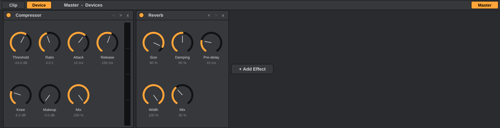

All tracks sum into the master channel. Signal order: **track sum → master effects → master
fader → level meter**. The metronome is added after the master fader, so master level does not
affect it.

- Open master effects using **Master** in the bottom panel, or click the master strip in Mixer view.
- Master effects process the entire mix. A master compressor, for example, responds to the sum
  rather than to individual tracks.
- The master fader is in [Mixer view](#17-mixer-view).

## 15. Automation

Automation lets you draw how a parameter changes over time, such as gradually opening a filter
or fading in a track.

### Automation lane

1. Press **A** in a track header to open an automation lane beneath it.
2. Choose a parameter from the list on the left: **Volume**, **Pan**, or any parameter of a
   built-in device on the track, such as "Synth: Filter cutoff", "Reverb: Mix", or
   "Drum Rack: pad1Gain". Parameters with automation have a **•** prefix.
3. The line shows the parameter's value over time. With no points, a dashed line shows its
   normal value and the lane reads "Click to add automation".

### Working with points

| Action | How |
| --- | --- |
| Add a point | Click empty space in the lane, then keep the button held and drag to adjust its position |
| Move | Drag a point. Time snaps to the grid (**Alt** disables snapping); points cannot cross their neighbors. **Shift** changes only the value |
| Delete | **Double-click** or **right-click** a point, or select it and press **Delete** |
| Delete all | Use **x** on the left to remove all automation for that parameter |
| Cancel | **Escape** while dragging |

Values interpolate linearly between points. Before the first point, its value applies; after
the last point, its value applies. For parameters such as frequency, the vertical axis is
logarithmic, like the knob. The value is displayed as text while dragging.

### Automated parameters

- Automated knobs, sliders, and faders **turn red** and move with the envelope during playback.
- Automation also applies while stopped: moving the playhead sets the parameter to the value
  at that position.
- Manually adjusting an automated knob is immediately overridden by the envelope. Remove its
  automation first if you want to change it manually.
- Automation updates roughly every 5 ms. Each parameter's smoothing prevents clicks on abrupt
  value changes.
- Deleting an effect also deletes its automation; undo restores both.

> VST3/LV2 plugin parameters cannot yet be automated.

## 16. Pattern mode (FL-style)

Pattern mode lets you hear the MIDI clip you are editing **loop on its own**, independently
of the rest of the song.

1. Double-click a MIDI clip to open it in the piano roll.
2. Press **PAT** in the top bar.
3. Press **Space** to play.

In Pattern mode:

- Only the clip's track plays; all other tracks are silent.
- Playback loops between the clip's start and end.
- The position bar shows only the clip and reads **PATTERN**.
- Editing piano-roll notes or adjusting the synth in the Device tab does not interrupt the loop.
- Moving or resizing the clip updates the loop to follow it.
- Opening another MIDI clip makes it the active pattern.

Press **SONG** to return to normal song playback. Pressing PAT without an open MIDI clip shows
a message asking you to open one first.

## 17. Mixer view

Press **Tab** or **Mixer** in the top bar to switch to Mixer view. Each track has a vertical
channel strip:

- **Name**
- **Pan knob:** displays C (center), or values such as "37L" and "50R". Double-click to center.
- **Activator (track number)** and **S (solo)**
- **Fader:** −60 dB (−inf) to +6 dB, with 0 dB about three-quarters up the travel. Double-click
  to reset to 0 dB.
- **Level meter:** its upper half covers −12 to +6 dB for finer detail. Click the red peak
  indicator to reset it.

The **Master** strip on the right has the master fader and meter. Clicking it opens master
effects in the bottom panel. All mixer edits are undoable and stay synchronized with the
arrangement's track headers.

## 18. VST3 and LV2 plugins

diyDaw hosts Linux **VST3** and **LV2** plugins as instruments and effects.

### Plugin Manager

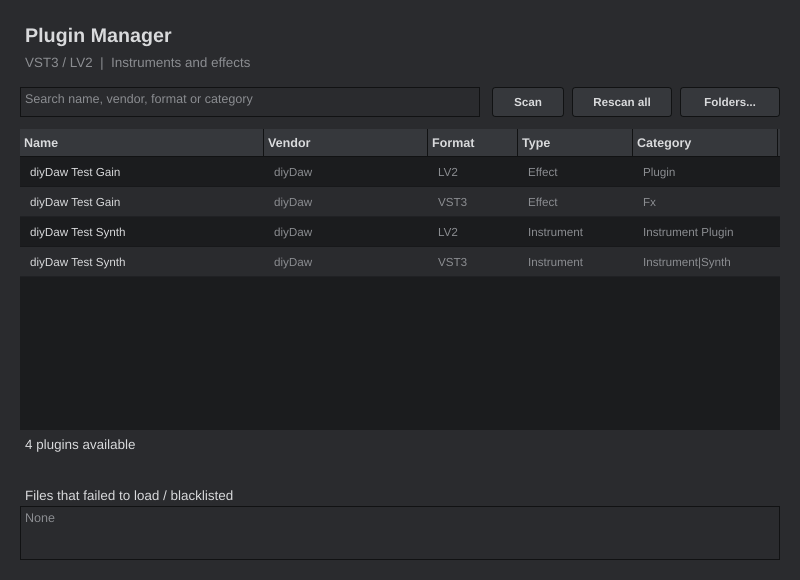

Open it with **File → Plugins...**.

- **Scan:** searches standard directories (`~/.vst3`, `/usr/lib/vst3`, `/usr/local/lib/vst3`,
  `~/.lv2`, `/usr/lib/lv2`, `/usr/local/lib/lv2`, ...) and your added folders, skipping files
  already scanned.
- **Rescan all:** scans everything again.
- **Folders...:** add / remove search folders, stored in application settings.
- **Search box:** filters by name, manufacturer, format, or category.
- Files that failed to load or were blacklisted appear at the bottom.

Scanning proceeds file by file to keep the UI responsive. If a plugin crashes the app during
scanning, it is **automatically blacklisted** on the next launch. The catalog is saved in
`~/.config/diyDaw/plugins.xml`, so it does not need to be rebuilt each time. An empty catalog
does not trigger automatic scanning; press **Scan** the first time.

### Adding plugins

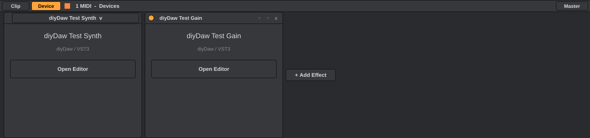

- **Effect:** in the Device tab, choose **+ Add Effect → Plugins → (manufacturer) → (plugin)**.
- **Instrument:** in a MIDI track's first device header, choose **Plugins → ...** from the
  drop-down. This replaces the current instrument, whether synth, drum rack, or another plugin.
  Use the same menu to return to **Synth** or **Drum Rack**.
- The plugin panel shows its name, manufacturer, and format. **Open Editor** opens its own UI
  in a separate window. If already open, the window comes to the front; deleting the plugin
  closes its editor.

### Plugins and project files

- All plugin settings (its internal state) are saved with the project and included in exports.
- Deleting a plugin and pressing **Ctrl+Z** restores it with its settings.
- Changes in the plugin's own UI mark the project as unsaved.
- A project still opens on a computer where a plugin is unavailable. Its device shows
  **Missing: ...** in red and remains silent. Install the plugin and reopen the project to
  restore it with its settings.

### Suggested free Linux plugins

| Plugin | Type | Installation |
| --- | --- | --- |
| Surge XT | Synth | surge-synthesizer.github.io (deb package) |
| Vital | Wavetable synth | vital.audio |
| LSP Plugins | EQ, compressor, limiter, ... | `sudo apt install lsp-plugins-lv2` |
| Dragonfly Reverb | Reverb | `sudo apt install dragonfly-reverb-lv2` |
| x42-plugins | Metering, EQ, utilities | `sudo apt install x42-plugins` |

### Test plugins

The project builds two small plugins for testing the host: **diyDaw Test Gain**, an effect
that adjusts level, and **diyDaw Test Synth**, an instrument that plays a sine wave for each
note. Both VST3 and LV2 versions are built into `build/tests/plugins`. To try them, add that
directory with **Folders...** in the Plugin Manager, then press **Scan**.

### Plugin limitations

- Plugin parameters cannot yet be automated.
- There is no plugin latency compensation. High-latency plugins, such as lookahead limiters,
  may play slightly behind other tracks.
- LV2 parameter changes reach the plugin in the next small audio-processing block, within a
  few milliseconds; this is imperceptible in practice.
- Only Linux plugins are supported. Windows plugins require a bridge such as yabridge, which
  has not yet been tested.

## 19. Projects: saving, opening, and files

The **File** menu:

| Command | Shortcut | Description |
| --- | --- | --- |
| New Project | Ctrl+N | Empty project with 2 MIDI and 2 audio tracks |
| Open... | Ctrl+O | Open a `.diydaw` file |
| Save | Ctrl+S | Save; asks for a filename the first time |
| Save As... | Ctrl+Shift+S | Save under another name |
| Export Audio... | Ctrl+Shift+R | Export as WAV |
| Plugins... | | Plugin Manager |

- Creating a new project, opening another, or quitting with unsaved changes prompts you to
  **Save / Don't Save / Cancel**.
- The default project directory is `~/Music/diyDaw`.
- You can also open a project by double-clicking a `.diydaw` file or running
  `diyDaw project.diydaw`. Double-clicking requires a desktop association; see
  [Troubleshooting](#25-troubleshooting).

### Where are audio files stored?

The project file stores references to audio files; it **does not copy** them. Each reference
includes both an absolute path and a path **relative to the project file**. Loading tries the
absolute path first, then the relative path if needed. This means:

- Keeping audio files next to the project file or in a subfolder lets you move the whole
  folder to another location or computer.
- Deleting or moving an audio file on its own makes the clip show **Missing file**.

Drum rack samples use the same approach. Built-in kit sounds are not files and are always
available.

See [file-format.md](file-format.md) for details of the project format.

## 20. Exporting audio

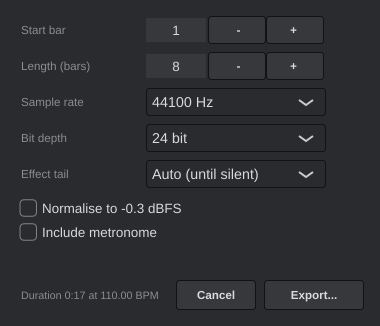

Choose **File → Export Audio...** (Ctrl+Shift+R):

| Option | Description |
| --- | --- |
| Start bar | First bar to export |
| Length (bars) | Number of bars to export. Defaults to the whole song, through the bar where the last clip ends |
| Sample rate | 44.1 / 48 / 88.2 / 96 kHz |
| Bit depth | 16-bit with TPDF dither, 24-bit, or 32-bit float |
| Effect tail | **Off**, **Auto (until silent)** (default), or a fixed 1 / 2 / 4 / 8 seconds |
| Normalise to −0.3 dBFS | Adjust level so the highest peak reaches −0.3 dBFS |
| Include metronome | Include the metronome in the output |

The export duration appears at the bottom. **Export...** asks for a filename and starts a
background render, with a progress window you can cancel at any time.

How it works:

- Export uses a **copy** of the project and a separate engine, independent of the audio device.
  You can keep playing and editing the song while exporting.
- Rendering is much faster than real time: a song lasting several minutes may finish in seconds.
- **Effect tail:** playback stops at the range end, releasing notes and ending clips, while
  rendering continues until reverb and delay decay. Auto stops after the signal stays below
  −90 dB for 250 ms, with a maximum tail of 10 seconds.
- Interrupted or canceled exports leave the destination intact. Audio is written to a
  temporary file, then moved into place on completion.

You can also export from the command line at 44.1 kHz / 24-bit with an automatic tail:

```bash
diyDaw --export output.wav project.diydaw
```

## 21. Audio settings

**Audio...** opens settings for the output device, sample rate, and buffer size.

- Linux uses **ALSA** by default. On PipeWire systems, it connects through ALSA to PipeWire
  without extra configuration.
- You can also select JACK if its server is running. Otherwise, terminal output may include
  harmless "Cannot connect to server socket" warnings.
- A smaller **buffer size** reduces latency but increases CPU load. 256–512 samples is a good
  starting point.
- If no audio device can open, the UI still works. Select another device in this dialog.

## 22. How undo works

- **Ctrl+Z** undoes; **Ctrl+Shift+Z** or **Ctrl+Y** redoes.
- Each **user gesture** is one step: dragging a fader regardless of how often its value
  changes, moving a clip, or deleting several notes in a single eraser drag.
- Undoable: clip and note edits, track names, volume/pan/mute/solo, tempo, master level, synth
  and drum rack parameters, effect addition/deletion/order/bypass/parameters, instrument
  replacement, automation points, and drum pad samples.
- Not undoable: adding tracks, track heights, and changes inside a plugin's own UI. Plugin
  UI changes live inside the plugin but are saved with the project.
- Opening or creating a project clears undo history.

## 23. Window layout and persistent settings

The transport and position bar stay fixed. The bottom panel height, track header column
width, and track heights can be resized by dragging.

Settings are stored in `~/.config/diyDaw/`:

| File | Contents |
| --- | --- |
| `diyDaw.settings` | Bottom panel height and open/closed state, header column width, plugin folders |
| `plugins.xml` | Scanned plugin catalog |
| `plugin-scan-in-progress.txt` | Helper file for detecting plugins that crash during scanning |

Deleting this directory resets all settings without affecting projects.

## 24. Example workflow

Make a short loop from an empty project:

1. Press **Ctrl+N** for a new project. Set the BPM box to 124.
2. Add a drum track with **+ Drums**. Double-click empty space on it to open a one-bar clip.
3. In the piano roll, double-click notes on the Kick row at beats 1, 2, 3, and 4. Add Snare on
   2 and 4, and Closed Hat on eighth notes.
4. Press **PAT**, then **Space** to loop the drums. Vary the hi-hat velocities in the velocity lane.
5. Add a synth track with **+ MIDI**, create a clip, and draw a simple bass line. In the Device
   tab, make a bass sound with Osc 2 Semi at −12 and a low Cutoff.
6. Return to **SONG**. Duplicate clips with **Ctrl+D** to fill 8 bars.
7. Add **+ Add Effect → Delay** to the synth track and **Compressor** to the master.
8. Press **A** on the synth track, choose "Synth: Filter cutoff", and draw a rising envelope
   over 8 bars.
9. Save with **Ctrl+S** and export to WAV with **Ctrl+Shift+R**.

For ready-made examples, open `examples/midi-demo.diydaw` (synth, effects, automation) or
`examples/drums-demo.diydaw` (drum rack).

## 25. Troubleshooting

| Symptom | Solution |
| --- | --- |
| No sound | Select the correct output with **Audio...**; check the master fader, track activators, and whether a track is soloed |
| Double-clicking a `.diydaw` file opens a browser | The file contains XML, so the system treats it as XML. Add a diyDaw MIME definition under `~/.local/share/mime/packages/` and a `~/.local/share/applications/diydaw.desktop` entry (see [development.md](development.md#desktop-integration)) |
| "Missing file" in a clip | The audio file was moved or deleted. Restore it to its original absolute or project-relative location and reopen the project |
| "Loading..." never finishes | The file may be corrupt or in an unsupported format |
| Plugin absent from the list | Press **Scan**; add nonstandard directories with **Folders...**; check the blacklist at the bottom |
| Plugin shows "Missing" | The plugin is not installed or could not load; the panel shows the error |
| Computer keyboard does not play notes | Check that a MIDI track is selected, Ctrl/Alt/Shift are released, and no text field such as a track name is being edited |
| "Cannot connect to server socket" in the terminal | No JACK server is running. This is harmless; audio uses ALSA/PipeWire |
| Stuck note | Stop and restart with Space to turn off all notes |

## Known limitations

- **No warp:** audio clips play at their own speed instead of following tempo.
- **No recording:** microphone / line-in audio and live MIDI notes cannot be recorded.
- **No automation recording:** automation must be drawn. There is no temporary manual override
  or Ableton-style “re-enable automation”; interpolation is linear only.
- **Plugins:** no parameter automation or latency compensation.
- **Clip editor:** no audio clip editor; only arrangement trimming and splitting.
- **Selection:** the arrangement supports one selected clip at a time.
- **Track count:** up to 16 tracks; deletion and reordering are not yet available.
- **Session view:** no Ableton-style clip-launching grid yet.
- **Time signature:** stored in the project file but not editable in the UI, which uses 4/4.
